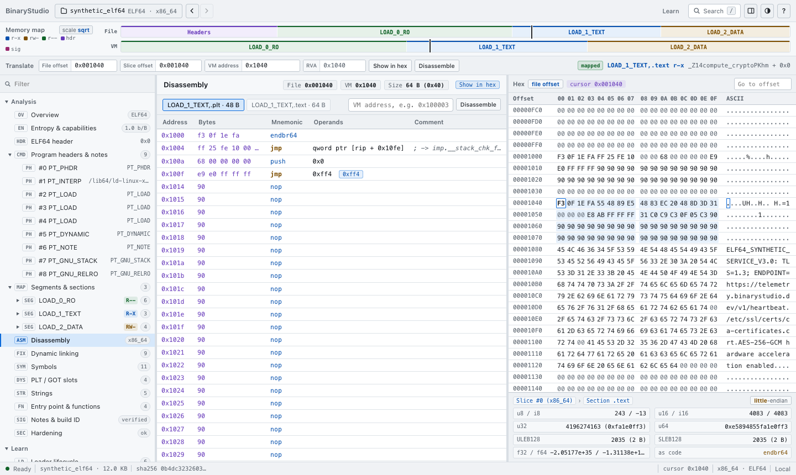
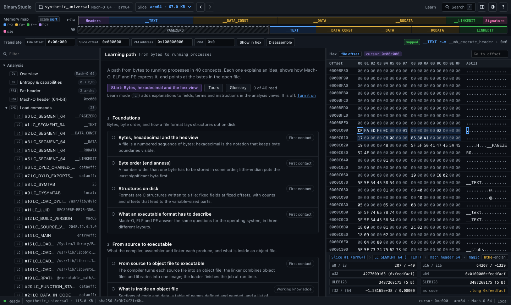

# BinaryStudio

BinaryStudio is a viewer and teaching tool for executable files: Apple Mach-O (thin and universal), Linux ELF32/ELF64 and Windows PE32/PE32+. It shows how a file is laid out, byte by byte, and explains what the operating system's loader does with each part. It never runs the files it opens.

The analysis engine is Python 3.9 standard library only; the interface is plain JavaScript with no build step. There is nothing to install with pip or npm.



## What it does

- **Analysis.** Headers, load commands, program and section headers, segments and sections, symbols, imports and exports, relocations and fixups, strings, code signatures (Mach-O code directory hashes and entitlements; for PE, the Authenticode image hash, whether the certificate table contains it, and the certificate names), a hardening checklist per format, entropy, capabilities inferred from imports, and a disassembly listing for AArch64 and x86/x86-64. Every field is tied to its bytes: selecting a field highlights it in the hex view, and selecting a byte shows which structures contain it. An address translator converts between file offset, slice offset, virtual address and RVA.
- **Learn.** A curriculum of short articles (from bytes and byte order to dynamic linking, loading, mitigations and signing), a glossary, a per-field reference, a cross-format comparison table and guided tours that ask questions about the open file. Learn mode adds explanations inside the analysis views.
- **Labs.** Patch a copy of a file and see a structural diff of what changed; apply guided experiments (for example, make the ELF stack executable) and read what real loaders would do; build a minimal ELF64 from a form; compare two files; take an instruction apart bit by bit; explore integer, floating-point and LEB128 encodings.

What it does not do: it is not a debugger, emulator or decompiler. It does not validate signatures: no certificate chain is evaluated for any format, and an ELF file is never reported as signed, because a build ID is not a signature. The disassembler is a linear listing; most SIMD, VEX/EVEX and x87 instructions are shown as data rather than decoded, and files for any other architecture (32-bit ARM, RISC-V, PowerPC, MIPS and so on) are parsed but not disassembled (see [Disassembly](docs/user-guide.md#disassembly) and [What the analysis claims](docs/user-guide.md#what-the-analysis-claims)). Parsers have hard caps on counts and sizes, so very large tables are truncated, and the document says so when that happens.

## Quick start

There are three ways to run it.

**1. On your own machine (local mode).** Requires Python 3.9 or newer.

```sh
python3 binary_viewer.py --open
```

This serves the interface on `http://127.0.0.1:8421` and opens it in your browser. Local mode can open any file your user account can read, so it only listens on loopback addresses and refuses to start on any other address.

**2. In a terminal.**

```sh
python3 binary_viewer.py --cli fixtures/synthetic_elf64
python3 binary_viewer.py --cli fixtures/synthetic_elf64 --disasm
python3 binary_viewer.py --cli fixtures/synthetic_pe64.exe --translate 0x140001000
python3 binary_viewer.py --cli fixtures/synthetic_universal --slice arm64 --json
```

**3. As a website.** Either build a static site that runs the engine in each visitor's browser (recommended: no server-side code, and files never leave the visitor's machine):

```sh
python3 tools/build_static.py --out dist/
python3 tools/build_static.py --serve dist/        # try it at http://127.0.0.1:8000
```

or run the Python server in public mode behind a TLS reverse proxy:

```sh
python3 binary_viewer.py --public --trust-proxy --allowed-host binarystudio.example.com
```

`--trust-proxy` is required behind a TLS proxy: without it the server cannot tell that browsers used HTTPS and refuses their uploads with 403. In public mode uploads are analysed in a small pool of worker processes that the server kills if they overrun; local mode, the command line and the static build analyse in-process.

The [hosting guide](docs/hosting.md) covers both, including the headers a static host must send and what has not been tested.

## Command line

`python3 binary_viewer.py --help` prints every option and environment variable. In short:

| Option | Effect |
|---|---|
| `--cli FILE` | Print a report on `FILE` and exit. Add `--json` for the full analysis document, `--slice N\|ARCH` to pick a slice of a universal file, `--disasm [VMADDR]` for 32 instructions from the entry point or an address, `--translate VALUE` to resolve an address or offset. |
| `--host`, `--port` | Bind address and port for the web interface (default `127.0.0.1:8421`; port `0` picks a free one). |
| `--file FILE` | Local mode: open `FILE` when the interface loads. |
| `--open` | Open the interface in the default browser. |
| `--public` | Public mode, for hosting. See the hosting guide. |
| `--allowed-host NAME`, `--trust-proxy` | Public mode: the site's host name, and trust in the reverse proxy's `X-Forwarded-For` / `X-Forwarded-Proto`. |

`macho_viewer.py` is an older name for the same program and accepts the same options.

## Samples

`fixtures/` holds six small binaries that the interface offers as samples: a universal Mach-O (x86_64 + arm64), an `MH_PRELOAD` firmware image, an ELF64 PIE, an ELF32 executable with an executable stack, and a PE32+ and a PE32 executable. The PE32+ sample has a correct header checksum and a structurally complete Authenticode signature made with a throw-away key; its certificates are named "BinaryStudio synthetic test fixture (not a real signer)" and chain to no real authority. They are committed to the repository. If they are missing, local mode regenerates them; the universal Mach-O needs `clang++`, `lipo` and `codesign` from Xcode, so it can only be rebuilt on macOS.

## Documentation

- [User guide](docs/user-guide.md): the workspace, shortcuts, search, the translator, Learn and each lab.
- [Hosting guide](docs/hosting.md): static build or Python server, every setting, reverse proxies, checklist.
- [Monetisation](docs/monetisation.md): the optional, off-by-default ads mechanism.
- [Architecture](docs/architecture.md): modules, the document model, the API, how to extend it.
- [Format internals](docs/format-internals.md): notes on the Mach-O, ELF and PE structures the parsers read.
- [SECURITY.md](SECURITY.md): threat model per mode, guarantees, residual risks, reporting.
- [CONTRIBUTING.md](CONTRIBUTING.md): tests, fuzzing, browser checks, coding rules.



## Status

Version 2.0.0 (`backend/runtime.py`). On 2026-11-11 the test suite (`python3 -m unittest discover -s tests -p 'test_*.py'`) ran 508 tests on macOS with Python 3.9.6, all passing. The interface has been exercised in desktop Chrome only, and nothing has been run on Linux or Windows: the files in `deploy/` and the Linux-only limits of the analysis workers are untested. See [What has and has not been tested](docs/hosting.md#what-has-and-has-not-been-tested) before you host it.
