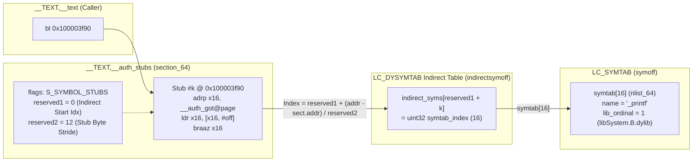
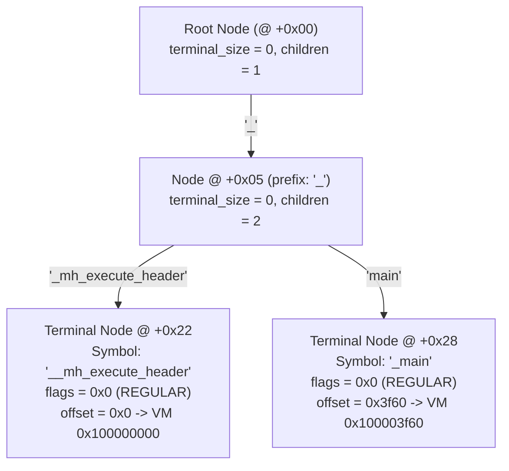
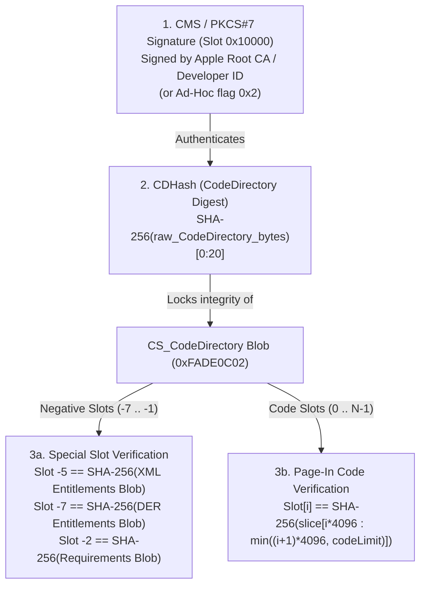
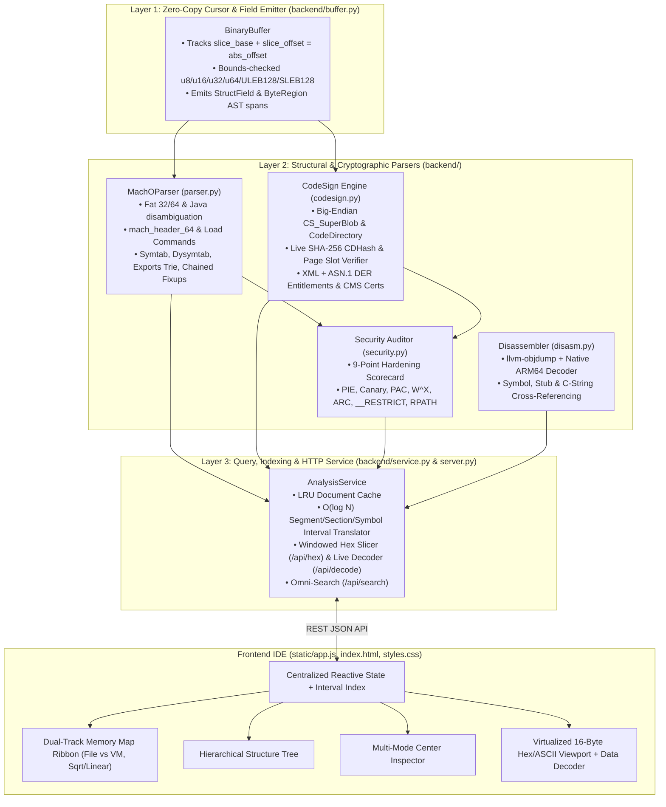
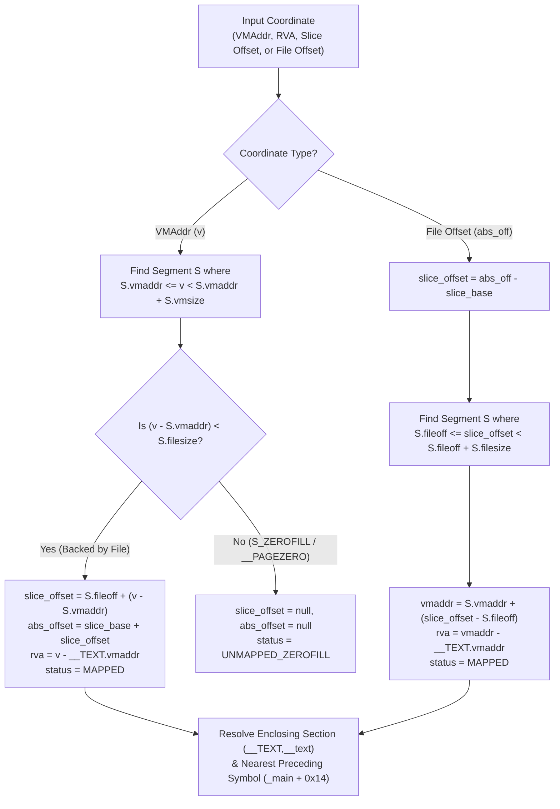

# The Inner Workings of Mach-O & the Mach-O File Viewer (`MachOStudio`)

This document provides a byte-level engineering reference for the **Mach-O (Mach Object)** binary format across macOS, iOS, watchOS, XNU kernels, and standalone Apple Silicon firmware (`iBoot`/`SecureROM`/`SEP`), paired with a deep architectural walkthrough of how **MachOStudio** (`macho_viewer`) parses, indexes, verifies, and visualizes binaries in real time.

---

## Table of Contents

1. [Byte-Level Anatomy of the Mach-O Binary Format](#1-byte-level-anatomy-of-the-mach-o-binary-format)
   - [1.1 Universal (Fat) 32-Bit & 64-Bit Containers](#11-universal-fat-32-bit--64-bit-containers)
   - [1.2 Disambiguating `0xCAFEBABE`: Mach-O Fat vs. Java Class Files](#12-disambiguating-0xcafebabe-mach-o-fat-vs-java-class-files)
   - [1.3 The Mach-O Header (`mach_header` & `mach_header_64`)](#13-the-mach-o-header-mach_header--mach_header_64)
   - [1.4 CPU Types & `ARM64E` Pointer Authentication (PAC) Subtype Encoding](#14-cpu-types--arm64e-pointer-authentication-pac-subtype-encoding)
   - [1.5 Userland vs. Kernel & Firmware File Types](#15-userland-vs-kernel--firmware-file-types)
2. [Deep Dive into Load Commands & Dynamic Linking](#2-deep-dive-into-load-commands--dynamic-linking)
   - [2.1 Segments (`LC_SEGMENT_64`), Sections, and `S_ZEROFILL` Mapping](#21-segments-lc_segment_64-sections-and-s_zerofill-mapping)
   - [2.2 Symbol Tables (`LC_SYMTAB`) & `nlist_64` Bitfield Decoding](#22-symbol-tables-lc_symtab--nlist_64-bitfield-decoding)
   - [2.3 Dynamic Symbol Table (`LC_DYSYMTAB`) & Indirect Symbol Stub Resolution](#23-dynamic-symbol-table-lc_dysymtab--indirect-symbol-stub-resolution)
   - [2.4 Exports Trie (`LC_DYLD_EXPORTS_TRIE`) & ULEB128 Prefix Tree Traversal](#24-exports-trie-lc_dyld_exports_trie--uleb128-prefix-tree-traversal)
   - [2.5 Chained Fixups (`LC_DYLD_CHAINED_FIXUPS`) & PAC Pointer Formats](#25-chained-fixups-lc_dyld_chained_fixups--pac-pointer-formats)
   - [2.6 Function Starts (`LC_FUNCTION_STARTS`) ULEB128 Delta Compression](#26-function-starts-lc_function_starts-uleb128-delta-compression)
   - [2.7 Entry Points: `LC_MAIN` vs. Firmware `LC_UNIXTHREAD` Register States](#27-entry-points-lc_main-vs-firmware-lc_unixthread-register-states)
3. [Deep Dive into Code Signing (`LC_CODE_SIGNATURE`)](#3-deep-dive-into-code-signing-lc_code_signature)
   - [3.1 Big-Endian `CS_SuperBlob` (`0xFADE0CC0`) Layout](#31-big-endian-cs_superblob-0xfade0cc0-layout)
   - [3.2 `CS_CodeDirectory` (`0xFADE0C02`) & Negative/Non-Negative Hash Slots](#32-cs_codedirectory-0xfade0c02--negativenon-negative-hash-slots)
   - [3.3 Live CDHash & Page-Level SHA-256 Verification Algorithm](#33-live-cdhash--page-level-sha-256-verification-algorithm)
   - [3.4 Entitlements: XML Plists (`0xFADE7171`) vs. CoreEntitlements ASN.1 DER (`0xFADE7172`)](#34-entitlements-xml-plists-0xfade7171-vs-coreentitlements-asn1-der-0xfade7172)
   - [3.5 CMS / PKCS#7 Cryptographic Signatures (`0xFADE0B01`)](#35-cms--pkcs7-cryptographic-signatures-0xfade0b01)
4. [Deep Dive into the Viewer's Architecture](#4-deep-dive-into-the-viewers-architecture)
   - [4.1 End-to-End Layered Engine Pipeline](#41-end-to-end-layered-engine-pipeline)
   - [4.2 Layer 1: `BinaryBuffer` & Automatic `StructField` Byte-Region Tracking](#42-layer-1-binarybuffer--automatic-structfield-byte-region-tracking)
   - [4.3 $O(\log N)$ Bidirectional Interval Index for Hex ↔ Structure Synchronization](#43-olog-n-bidirectional-interval-index-for-hex--structure-synchronization)
   - [4.4 Virtual Address (`VMAddr`) ↔ File Offset (`fileoff`) ↔ `RVA` Translation](#44-virtual-address-vmaddr--file-offset-fileoff--rva-translation)
   - [4.5 Automated Binary Hardening & Security Posture Analyzer](#45-automated-binary-hardening--security-posture-analyzer)
5. [Deep Dive into ELF32 & ELF64 Binary Internals (`backend/elf_parser.py`)](#5-deep-dive-into-elf32--elf64-binary-internals-backendelf_parserpy)
6. [Deep Dive into Windows PE32 & PE32+ Internals (`backend/pe_parser.py`)](#6-deep-dive-into-windows-pe32--pe32-internals-backendpe_parserpy)
7. [Semantic Intelligence & Interactive Systems Pedagogy (`backend/semantics.py` & `backend/pedagogy.py`)](#7-semantic-intelligence--interactive-systems-pedagogy-backendsemanticspy--backendpedagogypy)

---

## 1. Byte-Level Anatomy of the Mach-O Binary Format

### 1.1 Universal (Fat) 32-Bit & 64-Bit Containers

On macOS and iOS, a single file on disk can encapsulate multiple architecture-specific Mach-O binaries (slices)—such as `x86_64` and `arm64e`—inside a **Universal (Fat) Binary** wrapper defined in `<mach-o/fat.h>`.

Unlike thin Mach-O headers (which are typically little-endian on x86 and ARM), **the Fat header and its `fat_arch` descriptors are always stored in Big-Endian (network) byte order on disk**.

```text
+=============================================================================+
|                     UNIVERSAL (FAT) BINARY ON DISK                          |
+=============================================================================+
| 0x00000000: fat_header (8 bytes, Big-Endian)                                |
|   +0x00: magic     = 0xCAFEBABE (FAT_MAGIC) or 0xCAFEBABF (FAT_MAGIC_64)    |
|   +0x04: nfat_arch = 0x00000002 (2 architecture slices)                     |
+-----------------------------------------------------------------------------+
| 0x00000008: fat_arch[0] (20 bytes for 32-bit Fat, 32 bytes for 64-bit Fat)  |
|   +0x08: cputype    = 0x01000007 (CPU_TYPE_X86_64)                          |
|   +0x0C: cpusubtype = 0x00000003 (CPU_SUBTYPE_X86_64_ALL)                   |
|   +0x10: offset     = 0x00004000 (16,384 — page aligned 2^14)               |
|   +0x14: size       = 0x00011150 (69,968 bytes)                             |
|   +0x18: align      = 0x0000000E (14 -> 2^14 = 16,384 byte alignment)       |
+-----------------------------------------------------------------------------+
| 0x0000001C: fat_arch[1] (20 bytes)                                          |
|   +0x1C: cputype    = 0x0100000C (CPU_TYPE_ARM64)                           |
|   +0x20: cpusubtype = 0x80000002 (CPU_SUBTYPE_ARM64E | PAC ABI v0x80)       |
|   +0x24: offset     = 0x00018000 (98,304 — page aligned 2^14)               |
|   +0x28: size       = 0x000111F0 (70,128 bytes)                             |
|   +0x2C: align      = 0x0000000E (14 -> 2^14 = 16,384 byte alignment)       |
+-----------------------------------------------------------------------------+
| 0x00000030 .. 0x00003FFF: Zero Padding to 16 KB Page Boundary               |
+=============================================================================+
| 0x00004000: SLICE #0 (x86_64 Thin Mach-O, Little-Endian)                    |
|   +0x00: mach_header_64 (magic = 0xFEEDFACF, bytes: CF FA ED FE)            |
|   +0x20: Load Commands (LC_SEGMENT_64, LC_SYMTAB, LC_CODE_SIGNATURE...)     |
|   ...    Segments (__TEXT, __DATA_CONST, __DATA, __LINKEDIT)                |
+=============================================================================+
| 0x00018000: SLICE #1 (arm64e Thin Mach-O, Little-Endian)                    |
|   +0x00: mach_header_64 (magic = 0xFEEDFACF, bytes: CF FA ED FE)            |
|   ...    (All internal `fileoff` fields in Slice #1 are relative to         |
|           slice_base = 0x18000, NOT file start 0x0!)                        |
+=============================================================================+
```

#### 32-Bit (`fat_arch`) vs. 64-Bit (`fat_arch_64`) Entry Layout

| Magic | Hex Value | Entry Size | Layout (`>` Big-Endian) | Purpose |
| :--- | :--- | :--- | :--- | :--- |
| `FAT_MAGIC` | `0xCAFEBABE` | 20 bytes | `cputype` (`u32`), `cpusubtype` (`u32`), `offset` (`u32`), `size` (`u32`), `align` (`u32`) | Standard Universal binaries where slice offsets $< 4\text{ GB}$ |
| `FAT_MAGIC_64` | `0xCAFEBABF` | 32 bytes | `cputype` (`u32`), `cpusubtype` (`u32`), `offset` (`u64`), `size` (`u64`), `align` (`u32`), `reserved` (`u32`) | Large Universal binaries / dyld caches exceeding $4\text{ GB}$ |

> [!IMPORTANT]
> **The Dual-Offset Coordinate Contract:** Inside a Universal binary, every Mach-O internal offset (`segment_command_64.fileoff`, `section_64.offset`, `symtab_command.symoff`, `linkedit_data_command.dataoff`) is relative to the **start of that architecture's slice** (`slice_base`), whereas hex inspection operates on the **physical file offset** (`abs_offset = slice_base + slice_offset`). `BinaryBuffer` in [`backend/buffer.py`](../backend/buffer.py#L32-L66) tracks both coordinates simultaneously on every emitted field.

---

### 1.2 Disambiguating `0xCAFEBABE`: Mach-O Fat vs. Java Class Files

Both Universal Mach-O binaries and compiled Java bytecode (`.class`) files begin with the 4-byte sequence `CA FE BA BE` (`0xCAFEBABE` big-endian).

 Why does this collision exist, and how do `file(1)`, `lipo(1)`, XNU's `exec_mach_imgact`, and **MachOStudio** disambiguate them?
- **Java `.class` Layout:**
  - `+0x00..0x03`: `magic` = `0xCAFEBABE`
  - `+0x04..0x05`: `minor_version` (`uint16_t`)
  - `+0x06..0x07`: `major_version` (`uint16_t`, where Java 1.1 = `45` (`0x002D`) through Java 21 = `65` (`0x0041`)).
  - When interpreted as a 32-bit big-endian integer `nfat_arch` at `+0x04..0x07`, a Java class file with `minor=0, major=55` yields `nfat_arch = 55` (or if `minor != 0`, `nfat_arch >= 65536`).
- **MachOStudio's Multi-Constraint Verification (in [`parse_macho_bytes`](../backend/parser.py#L1710-L1842)):**
  1. **Bounded Architecture Count:** `1 <= nfat_arch <= 32` (Java class files have `major_version >= 45`).
  2. **Header & Slice Bounds Check:** For every `fat_arch[i]`, `offset >= sizeof(fat_header) + nfat_arch * sizeof(fat_arch)` and `offset + size <= file_size`.
  3. **Target Slice Magic Inspection:** The first 4 bytes at `file[fat_arch[i].offset]` must match a valid Mach-O magic (`0xFEEDFACE`, `0xFEEDFACF`, `0xCEFAEDFE`, `0xCFFAEDFE`) or static `ar` archive header (`!<arch>\n`).

---

### 1.3 The Mach-O Header (`mach_header` & `mach_header_64`)

Every Mach-O slice starts with a fixed-size header: **28 bytes** for 32-bit (`MH_MAGIC` = `0xFEEDFACE`) or **32 bytes** for 64-bit (`MH_MAGIC_64` = `0xFEEDFACF`). On Little-Endian architectures (`x86_64`, `arm64`), `0xFEEDFACF` appears on disk as bytes `CF FA ED FE`.

```text
 0                   1                   2                   3
 0 1 2 3 4 5 6 7 8 9 0 1 2 3 4 5 6 7 8 9 0 1 2 3 4 5 6 7 8 9 0 1
+-+-+-+-+-+-+-+-+-+-+-+-+-+-+-+-+-+-+-+-+-+-+-+-+-+-+-+-+-+-+-+-+
|                     magic (0xFEEDFACF)                        | +0x00
+-+-+-+-+-+-+-+-+-+-+-+-+-+-+-+-+-+-+-+-+-+-+-+-+-+-+-+-+-+-+-+-+
|                 cputype (e.g. 0x0100000C)                     | +0x04
+-+-+-+-+-+-+-+-+-+-+-+-+-+-+-+-+-+-+-+-+-+-+-+-+-+-+-+-+-+-+-+-+
|                cpusubtype (e.g. 0x80000002)                   | +0x08
+-+-+-+-+-+-+-+-+-+-+-+-+-+-+-+-+-+-+-+-+-+-+-+-+-+-+-+-+-+-+-+-+
|                  filetype (e.g. MH_EXECUTE=2)                 | +0x0C
+-+-+-+-+-+-+-+-+-+-+-+-+-+-+-+-+-+-+-+-+-+-+-+-+-+-+-+-+-+-+-+-+
|                        ncmds (uint32)                         | +0x10
+-+-+-+-+-+-+-+-+-+-+-+-+-+-+-+-+-+-+-+-+-+-+-+-+-+-+-+-+-+-+-+-+
|                      sizeofcmds (uint32)                      | +0x14
+-+-+-+-+-+-+-+-+-+-+-+-+-+-+-+-+-+-+-+-+-+-+-+-+-+-+-+-+-+-+-+-+
|                        flags (uint32)                         | +0x18
+-+-+-+-+-+-+-+-+-+-+-+-+-+-+-+-+-+-+-+-+-+-+-+-+-+-+-+-+-+-+-+-+
|                   reserved (uint32, 64-bit only)              | +0x1C
+-+-+-+-+-+-+-+-+-+-+-+-+-+-+-+-+-+-+-+-+-+-+-+-+-+-+-+-+-+-+-+-+
```

---

### 1.4 CPU Types & `ARM64E` Pointer Authentication (PAC) Subtype Encoding

The `cputype` and `cpusubtype` fields (decoded in [`decode_cpu_arch`](../backend/constants.py#L111-L166)) pack architecture width and capability bitmasks into the upper byte (`0xFF000000`):

- **`cputype` Encoding:**
  - Base architecture IDs occupy bits `0..23`: `CPU_TYPE_X86 = 7`, `CPU_TYPE_ARM = 12`.
  - Upper capability flags occupy bits `24..31` (`CPU_ARCH_MASK = 0xFF000000`):
    - `CPU_ARCH_ABI64 = 0x01000000` (64-bit LP64 pointers) $\rightarrow$ `CPU_TYPE_ARM64 = 0x0100000C` (`16777228`), `CPU_TYPE_X86_64 = 0x01000007` (`16777223`).
    - `CPU_ARCH_ABI64_32 = 0x02000000` (ARMv8 64-bit registers with 32-bit ILP32 pointers for watchOS) $\rightarrow$ `CPU_TYPE_ARM64_32 = 0x0200000C`.
- **`cpusubtype` & `ARM64E` PAC ABI Bitfield:**
  ```text
   31      24 23                                                    0
  +----------+-------------------------------------------------------+
  | Cap Bits |             Base CPU Subtype (0x00FFFFFF)             |
  | 0x80     |             0x00000002 (CPU_SUBTYPE_ARM64E)           |
  +----------+-------------------------------------------------------+
   ^-- Bit 31: PtrAuth ABI versioned flag + Bits 24..30: PAC ABI version
  ```
  - Masking with `~CPU_SUBTYPE_MASK` (`0x00FFFFFF`) extracts the base subtype:
    - `0` = `CPU_SUBTYPE_ARM64_ALL`
    - `1` = `CPU_SUBTYPE_ARM64_V8`
    - `2` = `CPU_SUBTYPE_ARM64E` (Apple Silicon A12+ / M1+ ARMv8.3-A Pointer Authentication)
  - Masking with `CPU_SUBTYPE_MASK` (`0xFF000000`) extracts the **Pointer Authentication (PAC) ABI capability byte** (`cap_bits = (cpusubtype >> 24) & 0xFF`). For example, `0x80000002` encodes `CPU_SUBTYPE_ARM64E` with versioned PAC ABI `v0x80`.

---

### 1.5 Userland vs. Kernel & Firmware File Types

The `filetype` field at `+0x0C` dictates how the operating system loader (`dyld` in userland, `XNU` kernel linker, or `iBoot` firmware loader) maps the image (defined in [`FILETYPE_INFO`](../backend/constants.py#L187-L202)):

| Constant | Value | Loader | Technical Semantics & Structural Characteristics |
| :--- | :--- | :--- | :--- |
| `MH_OBJECT` | `0x1` | `ld` | Relocatable compiler output (`.o`). Contains a single unnamed `LC_SEGMENT_64` encompassing all sections and section-level relocations (`reloff`/`nreloc`). |
| `MH_EXECUTE` | `0x2` | `XNU` + `dyld` | Demand-paged userland executable. Includes a 4 GB unmapped `__PAGEZERO` guard segment (`0x0..0x100000000`), `LC_LOAD_DYLINKER`, and `LC_MAIN`. |
| `MH_PRELOAD` | `0x5` | `iBoot` / Raw | **Standalone firmware / bootloader payload** (e.g., iBoot, SecureROM, SEP, embedded RTOS). Not demand-paged by XNU; lacks `__PAGEZERO` and `dyld`; uses `LC_UNIXTHREAD` to define initial CPU register states (`pc`, `sp`, `cpsr`) at a fixed physical/virtual base address. |
| `MH_DYLIB` | `0x6` | `dyld` | Dynamically bound shared library (`.dylib`). Base VM address starts at `0x0`; includes `LC_ID_DYLIB` defining its install name and compatibility versions. |
| `MH_DYLINKER` | `0x7` | `XNU` | The dynamic linker itself (`/usr/lib/dyld`), bootstrapped directly by the kernel alongside `MH_EXECUTE`. |
| `MH_BUNDLE` | `0x8` | `dlopen` | Runtime plugin bundle (`.bundle`) loaded dynamically via `dlopen()`. |
| `MH_DSYM` | `0xA` | `lldb` | Companion DWARF debug symbol package (`.dSYM`); segments have `filesize = 0` except for `__DWARF` and `__LINKEDIT`. |
| `MH_KEXT_BUNDLE` | `0xB` | `kmutil` / `XNU` | XNU Kernel Extension (`.kext`). Relies on kernel KPI symbol sets and `DYLD_CHAINED_PTR_ARM64E_KERNEL` fixups. |
| `MH_FILESET` | `0xC` | `iBoot` / `XNU` | **Monolithic Kernelcache or Dyld Shared Cache container.** Aggregates dozens or hundreds of constituent Mach-O images (`com.apple.kernel`, kexts) indexed via `LC_FILESET_ENTRY` (`0x80000035`) load commands. |

---

## 2. Deep Dive into Load Commands & Dynamic Linking

Immediately following `mach_header_64` (at slice offset `+0x20`) is an array of `ncmds` variable-length Load Commands totaling `sizeofcmds` bytes. Every load command begins with an 8-byte prefix:

```c
struct load_command {
    uint32_t cmd;      // Load command type (bit 31 = LC_REQ_DYLD 0x80000000)
    uint32_t cmdsize;  // Total byte length (multiple of 8 bytes on 64-bit)
};
```
If bit 31 (`LC_REQ_DYLD = 0x80000000`) is set on `cmd`, `dyld` **must** understand and process the command or abort loading the image.

---

### 2.1 Segments (`LC_SEGMENT_64`), Sections, and `S_ZEROFILL` Mapping

`LC_SEGMENT_64` (`0x19`) instructs the kernel's virtual memory subsystem (`vm_map`) how to map a contiguous range of file bytes (`fileoff .. fileoff + filesize`) into a contiguous range of virtual memory (`vmaddr .. vmaddr + vmsize`) with initial (`initprot`) and maximum (`maxprot`) `vm_prot_t` permissions (`R=1`, `W=2`, `X=4`).

```text
+-------------------------------------------------------------------------+
| segment_command_64 (72 bytes)                                           |
|   cmd (4B) | cmdsize (4B) | segname[16] (16B, e.g. "__TEXT\0...")       |
|   vmaddr (8B) | vmsize (8B) | fileoff (8B) | filesize (8B)              |
|   maxprot (4B)| initprot(4B)| nsects (4B)  | flags (4B)                 |
+-------------------------------------------------------------------------+
| Followed immediately by `nsects` * section_64 (80 bytes each):          |
|   sectname[16] (16B) | segname[16] (16B) | addr (8B) | size (8B)        |
|   offset (4B) | align (4B) | reloff (4B) | nreloc (4B) | flags (4B)     |
|   reserved1 (4B) | reserved2 (4B) | reserved3 (4B)                      |
+-------------------------------------------------------------------------+
```

#### Virtual Memory vs. File Offset Mapping & `S_ZEROFILL` Sections

A critical subtlety of Mach-O segments is that **`vmsize` can be strictly greater than `filesize`** ($S.\text{vmsize} \ge S.\text{filesize}$):

1. **`__PAGEZERO` (`vmsize = 0x100000000`, `filesize = 0`, `initprot = ---`):**
   Occupies the lower 4 GB of virtual address space (`0x0` to `0x100000000`) with zero bytes on disk (`fileoff = 0, filesize = 0`). Any null-pointer dereference or 32-bit truncated pointer access faults immediately.
2. **`S_ZEROFILL` (`__DATA,__bss` and `__DATA,__common`):**
   Uninitialized static/global variables (`static int buf[4096];`) are placed in `S_ZEROFILL` (`flags & 0xFF == 0x01`) or `S_THREAD_LOCAL_ZEROFILL` (`0x12`) sections at the **tail** of the `__DATA` segment:
   - In the `section_64` header, `addr` and `size` specify its virtual memory range, while `offset` on disk is `0`.
   - The enclosing `__DATA` segment has `vmsize = aligned(initialized_data_size + zerofill_size)` while `filesize = initialized_data_size`.
   - When the kernel maps `__DATA`, it maps `filesize` bytes from disk and demand-zeroes the remaining `vmsize - filesize` virtual pages in RAM.

```text
FILE ON DISK (__DATA)                 VIRTUAL MEMORY (__DATA)
+-----------------------+             +-----------------------+ <- S.vmaddr
| __got (Initialized)   | ----------> | __got                 |
| __nl_symbol_ptr       |   mmap()    | __nl_symbol_ptr       |
| __data (Initialized)  |             | __data                |
+-----------------------+ <-filesize  +-----------------------+ <- S.vmaddr + S.filesize
  (No bytes on disk!)                 | __bss (S_ZEROFILL)    | } Demand-zeroed pages
                                      | __common (S_ZEROFILL) | } in RAM (UNMAPPED_ZEROFILL)
                                      +-----------------------+ <- S.vmaddr + S.vmsize
```

---

### 2.2 Symbol Tables (`LC_SYMTAB`) & `nlist_64` Bitfield Decoding

`LC_SYMTAB` (`0x02`) points to an array of `nsyms` symbol entries at `symoff` and a null-terminated string pool of `strsize` bytes at `stroff`. On 64-bit Mach-O, each symbol entry is a 16-byte `nlist_64` structure:

```c
struct nlist_64 {
    uint32_t n_strx;   // +0x00: Byte offset into string table at stroff
    uint8_t  n_type;   // +0x04: Type & visibility bitfield
    uint8_t  n_sect;   // +0x05: 1-based section index (or NO_SECT = 0)
    uint16_t n_desc;   // +0x06: Flags, weak-def/ref, & two-level library ordinal
    uint64_t n_value;  // +0x08: Symbol VM address (or common alignment/size)
};
```

#### `n_type` (8-Bit Bitfield Breakdown)

```text
  7   6   5   4   3   2   1   0
+-----------+---+-----------+---+
|  N_STAB   |PEX|  N_TYPE   |EXT|
|  (0xE0)   |0x10|  (0x0E)  |0x1|
+-----------+---+-----------+---+
```
- **`N_STAB` (`0xE0`, bits `5..7`):** If any bit in `0xE0` is non-zero, the entry is a DWARF/stabs symbolic debugger entry (`N_GSYM`, `N_FUN`, `N_SO`, `N_OSO`).
- **`N_PEXT` (`0x10`, bit `4`):** Private external symbol (`__attribute__((visibility("hidden")))`)—visible across `.o` files during static linking, but turned into a local symbol in the final linked binary.
- **`N_TYPE` (`0x0E`, bits `1..3`):**
  - `N_UNDF` (`0x00`): Undefined symbol imported from an external dylib (or tentative common symbol if `n_value != 0`).
  - `N_ABS` (`0x02`): Absolute symbol (`n_value` is constant regardless of ASLR slide).
  - `N_SECT` (`0x0E`): Defined in the 1-based section index `n_sect` (`1 .. total_sections` flattened across all segments in order).
  - `N_PBUD` (`0x0C`): Prebound undefined symbol.
  - `N_INDR` (`0x0A`): Indirect alias for another symbol whose string table offset is in `n_value`.
- **`N_EXT` (`0x01`, bit `0`):** External (exported or imported global) symbol if set; file-local (`static`) symbol if clear.

#### `n_desc` (16-Bit Bitfield Breakdown)

```text
 15                           8 7   6   5   4   3      0
+------------------------------+---+---+---+---+--------+
|    LIBRARY_ORDINAL (8-bit)   |WK |WK |NDS|DYN|REF_FLAG|
|  (Two-Level Namespace Index) |REF|DEF|   |   | (0..7) |
+------------------------------+---+---+---+---+--------+
```
- **Bits `0..3` (`REFERENCE_TYPE`):** Undefined symbol reference nature (`UNDEFINED_NON_LAZY = 0`, `UNDEFINED_LAZY = 1`).
- **Bit `4` (`REFERENCED_DYNAMICALLY = 0x0010`):** Must not be stripped by `strip(1)`.
- **Bit `5` (`N_NO_DEAD_STRIP = 0x0020`):** Linker (`ld`) must preserve this symbol during `-dead_strip`.
- **Bit `6` (`N_WEAK_REF = 0x0040`):** Weakly imported reference (resolves to `0x0` at runtime if missing instead of faulting).
- **Bit `7` (`N_WEAK_DEF = 0x0080`):** Weak C++/inline definition (coalesced across images by `dyld`).
- **Bits `8..15` (`GET_LIBRARY_ORDINAL(n_desc) = (n_desc >> 8) & 0xFF`):** When `MH_TWOLEVEL` is set in `mach_header.flags`, every undefined symbol (`N_UNDF`) records the **1-based index** of the `LC_LOAD_DYLIB` command from which it must be resolved (`0x00` = `SELF_LIBRARY_ORDINAL`, `0xFE` = `DYNAMIC_LOOKUP_ORDINAL`, `0xFF` = `EXECUTABLE_ORDINAL`).

---

### 2.3 Dynamic Symbol Table (`LC_DYSYMTAB`) & Indirect Symbol Stub Resolution

To avoid linear scans over the entire `LC_SYMTAB`, `LC_DYSYMTAB` (`0x0B`) partitions the symbol table into three contiguous slices and provides the **Indirect Symbol Table** (`indirectsymoff`, `nindirectsyms` array of `uint32_t` indices) used to link call stubs (`__TEXT,__stubs` / `__TEXT,__auth_stubs`) and GOT/lazy pointers (`__DATA_CONST,__got`, `__DATA,__la_symbol_ptr`) to their target symbols.



#### The Exact Stub-to-Symbol Resolution Formula
For any section where `(section.flags & SECTION_TYPE) in (S_SYMBOL_STUBS, S_LAZY_SYMBOL_POINTERS, S_NON_LAZY_SYMBOL_POINTERS)`:
1. **`section.reserved1`** stores the starting index into the `LC_DYSYMTAB` indirect symbol array (`indirectsymoff`).
2. **`section.reserved2`** stores the byte stride of each stub (`stride = section.reserved2` for `S_SYMBOL_STUBS`, or pointer size `8` on 64-bit / `4` on 32-bit for pointer sections).
3. The $k$-th slot in the section (at virtual address $\text{slot\_vmaddr} = \text{section.addr} + k \times \text{stride}$) maps to:
   $$\text{symtab\_idx} = \text{uint32\_at}\big(\text{indirectsymoff} + 4 \times (\text{section.reserved1} + k)\big)$$
4. Special sentinel values in `symtab_idx`:
   - `INDIRECT_SYMBOL_LOCAL` (`0x80000000`): Local non-external symbol (only requires base-address slide rebase).
   - `INDIRECT_SYMBOL_ABS` (`0x40000000`): Absolute symbol.
   - Otherwise, `symtab[symtab_idx]` gives the exact `nlist_64` symbol (`_printf`, `_malloc`, etc.).

---

### 2.4 Exports Trie (`LC_DYLD_EXPORTS_TRIE`) & ULEB128 Prefix Tree Traversal

Instead of storing exported symbols as a flat array of strings, modern Mach-O files store exported symbols in a compact **Directed Acyclic Graph (DAG) Prefix Trie** pointed to by `LC_DYLD_EXPORTS_TRIE` (`0x80000033`) or `LC_DYLD_INFO_ONLY.export_off`.

#### ULEB128 (Unsigned Little-Endian Base 128) Variable-Length Integers
Every integer offset, flag, and address inside the Exports Trie and Function Starts table is encoded using **ULEB128** (implemented in [`BinaryBuffer.read_uleb128`](../backend/buffer.py#L150-L164)):
- Each byte contributes **7 bits of payload** (`byte & 0x7F`), shifted left by $0, 7, 14, 21, \dots$.
- **Bit 7 (`0x80`)** is the continuation bit: `1` means more bytes follow; `0` marks the final byte of the integer.

```text
Example: Decoding ULEB128 bytes [0xE0, 0x9E, 0x01]
  Byte 0: 0xE0 = 1_1100000b -> Bit 7 is 1 (continue), payload = 0x60 << 0  = 0x00060
  Byte 1: 0x9E = 1_0011110b -> Bit 7 is 1 (continue), payload = 0x1E << 7  = 0x00F00
  Byte 2: 0x01 = 0_0000001b -> Bit 7 is 0 (stop),     payload = 0x01 << 14 = 0x04000
  ----------------------------------------------------------------------------------
  Result: 0x04000 | 0x00F00 | 0x00060 = 0x4F60 (20,320)
```

#### Node Structure & Traversal Algorithm
Starting at the root node (`trie_offset = 0` relative to the exports blob), each node has the following binary layout:

```text
+-----------------------------------------------------------------------------+
| 1. terminal_size (ULEB128)                                                  |
|    - If terminal_size == 0: Non-terminal prefix node (skip to step 3).      |
|    - If terminal_size > 0:  The current accumulated prefix string IS an     |
|      exported symbol! Read `terminal_size` bytes of terminal export info:   |
|        • flags (ULEB128):                                                   |
|            - 0x00: EXPORT_SYMBOL_FLAGS_KIND_REGULAR                         |
|            - 0x01: EXPORT_SYMBOL_FLAGS_KIND_THREAD_LOCAL                    |
|            - 0x02: EXPORT_SYMBOL_FLAGS_KIND_ABSOLUTE                        |
|            - 0x04: EXPORT_SYMBOL_FLAGS_WEAK_DEFINITION                      |
|            - 0x08: EXPORT_SYMBOL_FLAGS_REEXPORT (followed by ordinal        |
|                    ULEB128 + imported_name C-string)                        |
|            - 0x10: EXPORT_SYMBOL_FLAGS_STUB_AND_RESOLVER (stub_offset       |
|                    ULEB128 + resolver_offset ULEB128)                       |
|        • symbol_offset (ULEB128): Offset from __TEXT.vmaddr!                |
|          Resolved VMAddr = __TEXT.vmaddr + symbol_offset.                   |
+-----------------------------------------------------------------------------+
| 2. child_count (uint8_t) at (node_pos + 1 + terminal_size_len + term_size)  |
+-----------------------------------------------------------------------------+
| 3. Repeated `child_count` times:                                            |
|    • edge_label (null-terminated ASCII C-string, e.g. "_mh_execute_header") |
|    • child_node_offset (ULEB128, relative to start of Exports Trie blob)    |
+-----------------------------------------------------------------------------+
```



> [!TIP]
> **Cycle-Detection Guard:** Malformed or intentionally obfuscated Mach-O binaries can encode cyclic `child_node_offset` edges that cause naive recursive parsers to stack-overflow. MachOStudio's trie walker in [`parse_exports_trie`](../backend/parser.py#L148-L232) maintains a `visited: Set[int]` of node offsets and enforces a depth/node budget.

---

### 2.5 Chained Fixups (`LC_DYLD_CHAINED_FIXUPS`) & PAC Pointer Formats

In macOS 12+ and iOS 15+, Apple replaced legacy `LC_DYLD_INFO_ONLY` opcode streams with **Chained Fixups** (`LC_DYLD_CHAINED_FIXUPS = 0x80000034`, decoded in [`parse_chained_fixups`](../backend/parser.py#L238-L483)). Instead of storing external tables listing every rebase and bind location, **the pointer slots inside `__DATA` / `__DATA_CONST` pages themselves form singly-linked lists (chains)** threaded through the unused upper bits of each 64-bit pointer on disk!

#### Structural Hierarchy in `__LINKEDIT`
1. **`dyld_chained_fixups_header` (28 bytes):** Contains `starts_offset` (offset to `dyld_chained_starts_in_image`), `imports_offset` (offset to the import table), `symbols_offset` (string pool), `imports_count`, and `imports_format` (`DYLD_CHAINED_IMPORT = 1`, `ADDEND = 2`, `ADDEND64 = 3`).
2. **`dyld_chained_starts_in_image`:** Contains `seg_count` followed by `seg_info_offset[seg_count]`.
3. **`dyld_chained_starts_in_segment`:** For each data segment with fixups, specifies:
   - `page_size` (`4096` or `16384` bytes)
   - `pointer_format` (e.g., `DYLD_CHAINED_PTR_ARM64E = 1`, `DYLD_CHAINED_PTR_64 = 2`, `DYLD_CHAINED_PTR_64_OFFSET = 6`, `DYLD_CHAINED_PTR_ARM64E_KERNEL = 7`, `DYLD_CHAINED_PTR_ARM64E_USERLAND24 = 12`)
   - `segment_offset`
   - `page_count` and `page_start[page_count]` (`uint16_t` byte offset of the **first** fixup pointer within that page, or `0xFFFF = DYLD_CHAINED_PTR_START_NONE` if the page has no fixups).

#### Walking a Page Chain & Decoding 64-Bit Bitfields

To resolve all fixups in page $p$, the parser starts at `slot_off = seg.fileoff + p * page_size + page_start[p]`, reads the 64-bit integer `raw64`, decodes the rebase or bind target, and advances `slot_off += next * stride` until `next == 0`:

```text
================================================================================
1. DYLD_CHAINED_PTR_64 / DYLD_CHAINED_PTR_64_OFFSET (Stride = 4 bytes)
================================================================================
Bit 63 == 0 -> REBASE:
 63  62        51 50     43 42                                                0
+---+------------+---------+---------------------------------------------------+
| 0 |  next (12) |high8 (8)|       target (43 bits: VMAddr or RVA Offset)      |
+---+------------+---------+---------------------------------------------------+

Bit 63 == 1 -> BIND:
 63  62        51 50               32 31        24 23                         0
+---+------------+-------------------+------------+----------------------------+
| 1 |  next (12) |   reserved (19)   | addend (8) |    import_ordinal (24)     |
+---+------------+-------------------+------------+----------------------------+

================================================================================
2. DYLD_CHAINED_PTR_ARM64E / USERLAND / KERNEL (Stride = 8 bytes, PAC-Enabled)
================================================================================
Bit 63 (auth) == 0, Bit 62 (bind) == 0 -> NON-AUTH REBASE:
 63  62  61         51 50     43 42                                           0
+---+---+-------------+---------+----------------------------------------------+
| 0 | 0 |  next (11)  |high8 (8)|              target (43 bits)                |
+---+---+-------------+---------+----------------------------------------------+

Bit 63 (auth) == 0, Bit 62 (bind) == 1 -> NON-AUTH BIND:
 63  62  61         51 50                  35 34             16 15            0
+---+---+-------------+----------------------+-----------------+---------------+
| 0 | 1 |  next (11)  |     addend (19)      |  reserved (16)  | ordinal (16)  |
+---+---+-------------+----------------------+-----------------+---------------+

Bit 63 (auth) == 1, Bit 62 (bind) == 0 -> AUTH REBASE (PAC-Signed Local Ptr):
 63  62  61         51 50  49 48  47         32 31                            0
+---+---+-------------+------+---+-------------+-------------------------------+
| 1 | 0 |  next (11)  |key(2)|aDv|diversity(16)|      target_rva (32 bits)     |
+---+---+-------------+------+---+-------------+-------------------------------+

Bit 63 (auth) == 1, Bit 62 (bind) == 1 -> AUTH BIND (PAC-Signed Imported Ptr):
 63  62  61         51 50  49 48  47         32 31           16 15            0
+---+---+-------------+------+---+-------------+---------------+---------------+
| 1 | 1 |  next (11)  |key(2)|aDv|diversity(16)| reserved (16) | ordinal (16)  |
+---+---+-------------+------+---+-------------+---------------+---------------+
```

#### Pointer Authentication (PAC) Parameters in `AUTH_REBASE` and `AUTH_BIND`
When `auth == 1` (Bit 63), `dyld` (or XNU / iBoot) signs the resolved 64-bit pointer in hardware using an ARMv8.3-A `PAC*` instruction before writing it to memory:
- **`key` (Bits `49..50`):** Selects one of the four hardware Pointer Authentication keys (`0 = IA` Instruction Key A, `1 = IB` Instruction Key B, `2 = DA` Data Key A, `3 = DB` Data Key B).
- **`addrDiv` (`aDv`, Bit `48`):** If `1`, the 64-bit virtual address where the pointer is stored (`&slot`) is blended into the cryptographic salt so a signed pointer cannot be copied from one GOT slot to another (**pointer substitution attack mitigation**).
- **`diversity` (Bits `32..47`):** A 16-bit compile-time type/context discriminator (e.g., C++ vtable method hash) blended into the PAC modifier register.

---

### 2.6 Function Starts (`LC_FUNCTION_STARTS`) ULEB128 Delta Compression

Even when a Mach-O binary is completely stripped of symbol names (`strip -x`), `LC_FUNCTION_STARTS` (`0x26`) preserves the exact entry address of every function in `__TEXT` for stack unwinding and crash symbolication.

The payload at `dataoff` (`datasize` bytes in `__LINKEDIT`) is a stream of **non-zero ULEB128 address deltas**:

```python
current_offset = 0  # Relative to __TEXT.fileoff (and __TEXT.vmaddr)
pos = dataoff
while pos < dataoff + datasize:
    delta, byte_len = buf.read_uleb128(pos)
    pos += byte_len
    if delta == 0:
        break
    current_offset += delta
    func_vmaddr = text_segment.vmaddr + current_offset
```
Because ARM64 instructions are 4-byte aligned, deltas are compact (typically 1–2 bytes per function). If `func_vmaddr` matches a symbol in `LC_SYMTAB`, MachOStudio labels it with that symbol name (e.g., `_main`); otherwise, it synthesizes an IDA/Binary Ninja-style label `sub_<vmaddr>`.

---

### 2.7 Entry Points: `LC_MAIN` vs. Firmware `LC_UNIXTHREAD` Register States

Mach-O supports two mechanisms for specifying the initial execution entry point:

1. **`LC_MAIN` (`0x80000028`, Modern Userland Executables):**
   Stores an 8-byte `entryoff` (offset from the start of the `__TEXT` segment) and `stacksize`. `dyld` computes:
   $$\text{Entry VMAddr} = \text{\_\_TEXT.vmaddr} + \text{entryoff}$$
2. **`LC_UNIXTHREAD` (`0x05`) / `LC_THREAD` (`0x04`) (Standalone Firmware `MH_PRELOAD`, XNU Kernels, & Legacy Binaries):**
   Because standalone firmware (`MH_PRELOAD`) boots directly on bare metal without `dyld`, `LC_UNIXTHREAD` embeds a complete CPU register state structure that the bootloader loads directly into hardware registers:

```text
+-----------------------------------------------------------------------------+
| LC_UNIXTHREAD (ARM64: flavor = ARM_THREAD_STATE64 (6), count = 68 uint32s)  |
+-----------------------------------------------------------------------------+
| +0x00: cmd = 0x5          | +0x04: cmdsize = 288                            |
| +0x08: flavor = 6         | +0x0C: count = 68 (272 bytes of register state) |
+-----------------------------------------------------------------------------+
| +0x10 .. +0xF7: x0 .. x28 (29 * uint64_t general-purpose registers)         |
| +0xF8: fp (x29, uint64_t) | +0x100: lr (x30, uint64_t link register)        |
| +0x108: sp (uint64_t)     | +0x110: pc (uint64_t -> ENTRY POINT VMADDR!)    |
| +0x118: cpsr (uint32_t)   | +0x11C: pad (uint32_t)                          |
+-----------------------------------------------------------------------------+
```

---

## 3. Deep Dive into Code Signing (`LC_CODE_SIGNATURE`)

Apple's code signing architecture embeds a self-contained cryptographic manifest at the end of `__LINKEDIT`, referenced by `LC_CODE_SIGNATURE` (`0x1D`).

> [!WARNING]
> **Endianness Switch:** Even inside a Little-Endian `arm64e` or `x86_64` Mach-O binary, **every structure inside `LC_CODE_SIGNATURE` is encoded in Big-Endian (`>`) network byte order!** In [`backend/codesign.py`](../backend/codesign.py#L293), `parse_code_signature` clones the slice's `BinaryBuffer` with `little_endian=False` so all `StructField` records decode big-endian primitives accurately.

---

### 3.1 Big-Endian `CS_SuperBlob` (`0xFADE0CC0`) Layout

The root container at `dataoff` is a `CS_SuperBlob` (`CSMAGIC_EMBEDDED_SIGNATURE = 0xFADE0CC0`), which acts as a directory of typed sub-blobs (`CS_BlobIndex`):

```text
+=============================================================================+
| CS_SuperBlob @ slice_offset = dataoff (Big-Endian `>`)                      |
+=============================================================================+
| +0x00: magic  = 0xFADE0CC0 (CSMAGIC_EMBEDDED_SIGNATURE)                     |
| +0x04: length = Total byte length of SuperBlob                              |
| +0x08: count  = N (Number of CS_BlobIndex entries following)                |
+-----------------------------------------------------------------------------+
| +0x0C: CS_BlobIndex[0]: type = 0x00000000 (CSSLOT_CODEDIRECTORY)            |
|                         offset = 0x00000034 (relative to SuperBlob start!)  |
| +0x14: CS_BlobIndex[1]: type = 0x00000002 (CSSLOT_REQUIREMENTS)             |
|                         offset = ...                                        |
| +0x1C: CS_BlobIndex[2]: type = 0x00000005 (CSSLOT_ENTITLEMENTS - XML)       |
|                         offset = ...                                        |
| +0x24: CS_BlobIndex[3]: type = 0x00000007 (CSSLOT_DER_ENTITLEMENTS - ASN.1) |
|                         offset = ...                                        |
| +0x2C: CS_BlobIndex[4]: type = 0x00010000 (CSSLOT_SIGNATURESLOT - CMS)      |
|                         offset = ...                                        |
+=============================================================================+
```

---

### 3.2 `CS_CodeDirectory` (`0xFADE0C02`) & Negative/Non-Negative Hash Slots

The **CodeDirectory** (`CSMAGIC_CODEDIRECTORY = 0xFADE0C02`) is the cryptographic heart of the signature. Its header (parsed in [`_parse_code_directory`](../backend/codesign.py#L488-L653)) defines:
- `version`: Format version (`0x20100` adds `scatterOffset`; `0x20200` adds `teamOffset`; `0x20400` adds `execSegBase`, `execSegLimit`, `execSegFlags`).
- `flags`: Bitmask of enforcement policies (`CS_ADHOC = 0x2`, `CS_HARD = 0x100`, `CS_KILL = 0x200`, `CS_RESTRICT = 0x800`, `CS_ENFORCEMENT = 0x1000`, `CS_REQUIRE_LV = 0x2000`, `CS_RUNTIME = 0x10000`, `CS_LINKER_SIGNED = 0x20000`).
- `hashOffset`: Byte offset (relative to the start of `CS_CodeDirectory`) of **Code Slot `0`**.
- `identOffset` & `teamOffset`: Offsets to null-terminated Identifier (e.g., `com.apple.ls`) and Team ID strings.
- `nSpecialSlots` & `nCodeSlots`: Counts of special metadata hashes and 4 KB (`2^pageSize`) binary page hashes.
- `codeLimit`: File byte offset up to which the Mach-O slice is hashed (everything prior to `LC_CODE_SIGNATURE`).

#### How Special Slots (`-7 .. -1`) and Code Slots (`0 .. N-1`) Are Arranged in Memory

A unique design feature of `CS_CodeDirectory` is that **`hashOffset` points to the middle of the hash array (Slot `0`)**:
- **Negative indices (`-nSpecialSlots` up to `-1`)** are stored immediately **before** `hashOffset`, at `cd_off + hash_offset - (s_idx * hashSize)`.
- **Non-negative indices (`0` up to `nCodeSlots - 1`)** are stored starting **at** `hashOffset`, at `cd_off + hash_offset + (page_idx * hashSize)`.

```text
+-----------------------------------------------------------------------------+
| CS_CodeDirectory Header (version, flags, hashOffset, identOffset, ...)      |
+-----------------------------------------------------------------------------+
| Identifier String ("com.apple.ls\0") & Team ID String                       |
+=============================================================================+
| Slot -7 (cd_off + hashOffset - 7*32): SHA-256 of DER Entitlements Blob      |
| Slot -6 (cd_off + hashOffset - 6*32): SHA-256 of RepSpecific / DMG          |
| Slot -5 (cd_off + hashOffset - 5*32): SHA-256 of XML Entitlements Blob      |
| Slot -4 (cd_off + hashOffset - 4*32): SHA-256 of App Specific               |
| Slot -3 (cd_off + hashOffset - 3*32): SHA-256 of Resource Directory         |
| Slot -2 (cd_off + hashOffset - 2*32): SHA-256 of Internal Requirements Blob |
| Slot -1 (cd_off + hashOffset - 1*32): SHA-256 of Info.plist                 |
+=============================================================================+ <-- hashOffset
| Slot  0 (cd_off + hashOffset + 0*32): SHA-256 of Slice Bytes [0x0000..0x0FFF]|
| Slot  1 (cd_off + hashOffset + 1*32): SHA-256 of Slice Bytes [0x1000..0x1FFF]|
| ...                                                                         |
| Slot N-1: SHA-256 of Slice Bytes [(N-1)*4096 .. min(N*4096, codeLimit)]     |
+=============================================================================+
```

---

### 3.3 Live CDHash & Page-Level SHA-256 Verification Algorithm

When the macOS kernel (`amfi` / XNU pager) validates a Mach-O binary, it uses a **two-tier Merkle-like verification chain**, which MachOStudio replicates live against the on-disk binary in [`_parse_code_directory`](../backend/codesign.py#L566-L630):



1. **Computing the `CDHash`:**
   - The entire raw byte span of the `CS_CodeDirectory` sub-blob (`cd_off .. cd_off + length`) is hashed with `hashType` (typically `SHA-256`).
   - The **full digest** is 32 bytes (64 hex chars), and the canonical **truncated `CDHash`** reported by `codesign -dvvv` is the first **20 bytes** (40 hex chars): `sha256(raw_cd_bytes)[:20].hex()`.
2. **Verifying Special Slots (`-2`, `-5`, `-7`):**
   - For each special slot $-s$ where the 32-byte slot hash is non-zero, MachOStudio hashes the corresponding raw sub-blob from the `CS_SuperBlob` (including its 8-byte `magic + length` header!) and checks `sha256(slot_raw_blobs[sb_type]) == expected_slot_hash`.
3. **Verifying Code Page Slots (`0 .. nCodeSlots - 1`):**
   - For page $p$, the slice byte range is `[p * page_size, min((p + 1) * page_size, code_limit)]`.
   - MachOStudio computes `actual_hash = sha256(slice_bytes)` and compares it byte-for-byte against `CodeDirectory` slot $p$. If any byte in `__TEXT` or `__DATA` is patched on disk without re-signing, `verified` immediately flips to `False`.

---

### 3.4 Entitlements: XML Plists (`0xFADE7171`) vs. CoreEntitlements ASN.1 DER (`0xFADE7172`)

Signed Mach-O binaries can carry entitlements in two parallel formats inside `CS_SuperBlob`:
1. **`CSSLOT_ENTITLEMENTS` (Slot `5`, Magic `0xFADE7171`):**
   After the 8-byte blob header (`0xFADE7171` + 4-byte big-endian `length`), the payload is an UTF-8 XML Property List (`<?xml version="1.0"...><plist><dict>...`), parsed via `plistlib.loads()`.
2. **`CSSLOT_DER_ENTITLEMENTS` (Slot `7`, Magic `0xFADE7172`):**
   Introduced for fast, allocation-free parsing inside the XNU kernel (`CoreEntitlements`). Uses **ASN.1 DER** (Distinguished Encoding Rules) TLV (Tag-Length-Value) encoding:
   - Tag `0x30` (`SEQUENCE`) / `0x31` (`SET`) / Constructed Context Tags (`tag & 0x20`) wrap key-value sequences.
   - Each key-value pair is a `SEQUENCE (0x30)` containing a `UTF8String (0x0C)` key followed by a `BOOLEAN (0x01)`, `INTEGER (0x02)`, `UTF8String (0x0C)`, or nested `SEQUENCE` array/dictionary.
   - [`decode_der_entitlements`](../backend/codesign.py#L144-L197) implements a zero-dependency recursive ASN.1 DER decoder so binaries that strip XML entitlements and retain only DER entitlements still display full key-value dictionaries and risk ratings (`HIGH` / `MEDIUM` / `LOW` / `INFO`).

---

### 3.5 CMS / PKCS#7 Cryptographic Signatures (`0xFADE0B01`)

Slot `0x10000` (`CSSLOT_SIGNATURESLOT`) has magic `CSMAGIC_BLOBWRAPPER` (`0xFADE0B01`).
- **Ad-Hoc Signatures (`codesign -s -`):** Either omit Slot `0x10000` or include an empty 8-byte wrapper (`length == 8`, payload `0` bytes) and set `CS_ADHOC (0x02)` in `CS_CodeDirectory.flags`.
- **Full Cryptographic Signatures (Apple System / Developer ID):** Embed a DER-encoded **RFC 5652 CMS (`SignedData`) / PKCS#7** structure containing the X.509 certificate chain (`Leaf Signer -> Intermediate Authority -> Apple Root CA`). [`parse_cms_certificates`](../backend/codesign.py#L234-L264) scans the ASN.1 DER structure for X.509 Attribute OIDs (`2.5.4.3` Common Name `\x06\x03\x55\x04\x03` and `2.5.4.10` Organization `\x06\x03\x55\x04\x0a`) to extract every certificate's `Subject CN`, `Issuer CN`, and `Organization` without requiring external OpenSSL bindings.

---

## 4. Deep Dive into the Viewer's Architecture

### 4.1 End-to-End Layered Engine Pipeline

MachOStudio is architected as a **zero-dependency, 3-layer backend engine** (`backend/`) paired with a **virtualized desktop-class Web IDE** (`static/`) and a **headless CLI** (`macho_viewer.py`).



---

### 4.2 Layer 1: `BinaryBuffer` & Automatic `StructField` Byte-Region Tracking

A common anti-pattern in binary viewers is duplicating struct definitions—once to parse values and a second time to compute offsets for the UI table and hex highlighter.

In MachOStudio, [`BinaryBuffer`](../backend/buffer.py#L32-L233) unifies parsing and layout tracking:
1. When parsing a slice inside a Universal binary at `slice_base` (e.g., `0x18000`), `sub_slice(slice_base, slice_size, little_endian)` creates a scoped view over the underlying file `bytes`.
2. As the parser reads fields via `u8`, `u16`, `u32`, `u64`, `fixed_cstr`, or `read_uleb128`, it calls [`record_field(...)`](../backend/buffer.py#L185-L233), which automatically captures:
   - `abs_offset = self.slice_base + slice_offset` (exact physical byte coordinate in the file)
   - `slice_offset` (offset relative to the Mach-O slice start)
   - `size` (field byte width)
   - `raw_hex` (the exact bytes on disk in file order, e.g., `"0c 00 00 01"`)
   - `value` & `interpreted` (formatted scalar value and symbolic constant decoding)
   - `bit_flags` (decoded bitmask breakdown for expandable flag pills)
   - `target_offset` / `target_vmaddr` (cross-reference jump target for offset/address fields)

---

### 4.3 $O(\log N)$ Bidirectional Interval Index for Hex ↔ Structure Synchronization

To achieve instantaneous bidirectional synchronization between the **Center Inspector**, **Structure Tree**, **Dual Memory Map Ribbon**, and **Virtualized Hex/ASCII Pane**—even on 100+ MB binaries where rendering all DOM rows would freeze the browser—MachOStudio uses two key mechanisms:

#### 1. Viewport-Virtualized Hex Grid ($O(1)$ Mounted DOM Nodes)
- A 100 MB binary contains $6,553,600$ 16-byte rows. Instead of mounting millions of DOM nodes, [`renderHexViewport`](../static/app.js#L2286-L2369) calculates `startRow = Math.floor(scrollTop / HEX_ROW_HEIGHT)` and renders only the **~45 visible rows** plus a small overscan buffer, fetching 4 KB byte chunks on demand via [`ensureHexChunk`](../static/app.js#L2240-L2273) $\rightarrow$ [`AnalysisService.get_hex_slice`](../backend/service.py#L268-L334) (`GET /api/hex`).

#### 2. Hierarchical Span & Interval Lookup (`Inspector ↔ Hex`)
Every structural node and `StructField` in [`_parse_macho_slice`](../backend/parser.py#L489-L1704) carries a `[abs_offset, abs_offset + size)` interval:

```text
File Offset:  0x18000                                              0x291F0
              |------------------- Slice #1 (arm64e) --------------------|
              |------------ LC_SEGMENT_64 (__TEXT, 16 KB) --------|
              |--- mach_header_64 (32B) ---|
              |[magic 4B][cputype 4B]...   |
```

- **Forward Sync (`Inspector / Tree -> Hex`):**
  Clicking any tree node ([`selectTreeNode`](../static/app.js#L680-L721)), memory map block ([`renderMemoryMapRibbon`](../static/app.js#L723-L870)), load command, symbol, or `StructField` invokes [`setCursorAndHighlight`](../static/app.js#L2384-L2415) with `structSpan` and `fieldSpan`. The Hex Viewport scrolls smoothly via [`scrollHexToOffset`](../static/app.js#L2371-L2382), tinting the parent structure's byte range in translucent blue and drawing a high-contrast border around the exact field bytes.
- **Reverse Sync (`Hex Byte Click -> Ownership Breadcrumb & Decoder`):**
  Clicking any byte at `abs_offset` in the Hex Grid queries the interval index via [`fetchLiveByteDecode`](../static/app.js#L2417-L2435) $\rightarrow$ [`AnalysisService.decode_bytes_at`](../backend/service.py#L339-L452) (`GET /api/decode`) to find all intervals $[a, b)$ where $a \le \text{abs\_offset} < b$, sorted from **coarsest container to deepest nested field**:
  $$\text{Slice \#1 (arm64e)} \rightarrow \text{LC\_SEGMENT\_64 (\_\_TEXT)} \rightarrow \text{mach\_header\_64} \rightarrow \text{cputype (0x0100000C)}$$
  Simultaneously, the **Live Byte Decoder** ([`renderByteDecoderCard`](../static/app.js#L2437-L2472)) decodes the 1–16 bytes starting at `abs_offset` into `int8`/`uint8`, `int16`/`uint16`, `int32`/`uint32`, `int64`/`uint64`, `float32`/`float64`, `ULEB128`, `SLEB128`, null-terminated ASCII preview, and a 4-byte ARM64 instruction disassembly preview via [`decode_single_arm64_preview`](../backend/disasm.py#L238-L244).

---

### 4.4 Virtual Address (`VMAddr`) ↔ File Offset (`fileoff`) ↔ `RVA` Translation

Reverse engineers constantly translate between an address seen in a crash log or disassembler (`0x100003f60`), a Relative Virtual Address (`RVA = +0x3f60`), a Mach-O slice offset (`0x3f60`), and a physical file offset (`0x1bf60`).

MachOStudio's translator ([`AnalysisService.translate_address`](../backend/service.py#L112-L263) backing `GET /api/translate` and [`runTranslateQuery`](../static/app.js#L2474-L2489) in the live `TRANSLATE` toolbar) resolves any coordinate in $O(\log N)$ time across segment, section, and symbol intervals:



---

### 4.5 Automated Binary Hardening & Security Posture Analyzer

Implemented in [`evaluate_security_posture`](../backend/security.py#L19-L336), MachOStudio automatically audits every Mach-O slice against **9 binary hardening criteria**:

| Check ID | Security Mechanism | How MachOStudio Verifies It at the Binary Level |
| :--- | :--- | :--- |
| `pie` | **Position Independent Executable (ASLR)** | Checks `MH_PIE` (`0x00200000`) in `mach_header.flags` for `MH_EXECUTE` binaries (or marks `MH_PRELOAD` firmware as fixed-base `INFO`). |
| `stack_canary` | **Stack Smashing Protection** | Scans `LC_SYMTAB` undefined/defined symbols for `___stack_chk_guard` and `___stack_chk_fail`. |
| `pac` | **Pointer Authentication (ARM64e PAC)** | Checks `cputype == CPU_TYPE_ARM64` with `(cpusubtype & 0xFF) == CPU_SUBTYPE_ARM64E` (`2`) or `DYLD_CHAINED_PTR_ARM64E*` pointer formats in `LC_DYLD_CHAINED_FIXUPS`. |
| `rwx` | **$\text{W}\oplus\text{X}$ Memory Hygiene** | Inspects `initprot` and `maxprot` on every `LC_SEGMENT_64` for simultaneous `VM_PROT_WRITE (0x2)` and `VM_PROT_EXECUTE (0x4)`, plus `MH_ALLOW_STACK_EXECUTION` (`0x20000`) in `mach_header.flags`. |
| `arc` | **Automatic Reference Counting (ARC)** | Scans `LC_SYMTAB` for Objective-C/Swift ARC runtime primitives (`_objc_release`, `_objc_retain`, `_objc_storeStrong`, `_objc_autoreleaseReturnValue`). |
| `restrict` | **Dyld Injection Hardening** | Checks for a `__RESTRICT,__restrict` section, `CS_RUNTIME` (`0x10000` Hardened Runtime), `CS_REQUIRE_LV` (`0x2000` Library Validation), or `CS_RESTRICT` (`0x800`) in `CS_CodeDirectory.flags`. |
| `rpath` | **Dynamic `@rpath` Hygiene** | Audits all `LC_RPATH` entries for relative paths (`.`), `/tmp`, or `/var/tmp` vulnerable to dylib hijacking. |
| `codesign` | **Code Signature & Live `CDHash` Integrity** | Verifies presence of `LC_CODE_SIGNATURE`, distinguishes Ad-Hoc vs. CMS-signed binaries, and cryptographically verifies special and page-level SHA-256 slots against on-disk bytes. |
| `encryption` | **Binary Segment Encryption** | Inspects `LC_ENCRYPTION_INFO` / `LC_ENCRYPTION_INFO_64` (`cryptid`, `cryptoff`, `cryptsize`) to detect FairPlay-encrypted segments. |

---

### 4.6 Hybrid ARM64 / x86_64 Disassembler & ADRP+ADD Cross-Referencer

Implemented in [`disassemble_window`](../backend/disasm.py#L265-L469) and [`decode_arm64_insn`](../backend/disasm.py#L34-L236), MachOStudio provides a dual-backend disassembly engine:
1. **Deterministic Pure-Python AArch64 (`ARM64` / `ARM64e`) Decoder:** Decodes PAC/BTI instructions (`paciasp`, `pacibsp`, `autiasp`, `autibsp`, `retaa`, `retab`, `braa`, `blraa`, `bti`), PC-relative page addressing (`adrp`, `adr`), branches (`b`, `bl`, `b.<cond>`, `cbz`, `cbnz`, `br`, `blr`, `ret`), register-pair stack frames (`stp`, `ldp` with pre/post/signed indexing), loads/stores (`ldr`, `str`, `ldrb`, `strb`, `ldrh`, `strh`), arithmetic/moves (`add`, `sub`, `cmp`, `mov`, `movz`, `movn`, `movk`), and exceptions (`svc`, `brk`, `udf`).
2. **Automatic `ADRP` + `ADD` Page-Offset Tracker:** As [`disassemble_window`](../backend/disasm.py#L412-L449) walks an ARM64 instruction stream, it tracks register page bases loaded by `adrp Xd, <page_base>`. When a subsequent `add Xd, Xn, #<page_off>` completes the 64-bit pointer calculation ($\text{target\_vm} = \text{page\_base} + \text{page\_off}$), the engine resolves $\text{target\_vm}$ against `__TEXT,__cstring` literals, `LC_SYMTAB`, `LC_FUNCTION_STARTS`, and `LC_DYSYMTAB` indirect symbol stubs (`imp._printf`), annotating the instruction inline.
3. **`llvm-objdump` / Pure-Python x86_64 & i386 Integration:** For Intel slices in Universal binaries as well as ELF32/64 and Windows PE32/PE32+ binaries, [`disassemble_window`](../backend/disasm.py#L515-L685) pairs system `llvm-objdump` / `objdump` with a built-in zero-dependency **x86 / x86_64 instruction decoder** ([`decode_x86_64_insn`](../backend/disasm.py#L251-L512)) that decodes CET `endbr64`/`endbr32`, REX prefixes, stack frame setup (`push`, `pop`, `sub rsp`), RIP-relative `lea`/`mov`, direct & indirect `call`/`jmp`, and conditional jumps (`je`, `jne`, `jg`, `jl`), automatically cross-referencing RIP-relative and branch targets against symbols, imports, and strings.

---

## 5. Deep Dive into ELF32 & ELF64 Binary Internals (`backend/elf_parser.py`)

Implemented in [`parse_elf_slice`](../backend/elf_parser.py#L628-L1658), MachOStudio parses **ELF32 (`ELFCLASS32 = 1`)** and **ELF64 (`ELFCLASS64 = 2`)** binaries across Little-Endian (`ELFDATA2LSB = 1`) and Big-Endian (`ELFDATA2MSB = 2`) architectures (`EM_X86_64`, `EM_386`, `EM_AARCH64`, `EM_ARM`, `EM_RISCV`, `EM_PPC64`, `EM_MIPS`).

### 5.1 Dual-Table Architecture: Program Headers (`Elf_Phdr`) vs. Section Headers (`Elf_Shdr`)
Unlike Mach-O (where sections are nested inside `LC_SEGMENT_64` load commands), ELF separates the **execution view** from the **linking view**:
- **Program Header Table (`e_phoff`, `e_phnum * e_phentsize`):** Read by the OS kernel (`fs/binfmt_elf.c`) and `ld-linux.so` at runtime. Key segment types include:
  - `PT_LOAD` (`1`): Maps `[p_offset, p_offset + p_filesz)` into `[p_vaddr, p_vaddr + p_memsz)` with `PF_R (4) | PF_W (2) | PF_X (1)`. Any excess `p_memsz - p_filesz` is demand-zeroed `.bss`.
  - `PT_DYNAMIC` (`2`): Points to the `.dynamic` tag array (`DT_NEEDED`, `DT_RUNPATH`, `DT_RPATH`, `DT_INIT_ARRAY`, `DT_FLAGS`, `DT_FLAGS_1`, `DT_RELA`, `DT_JMPREL`).
  - `PT_INTERP` (`3`): Null-terminated path to the runtime dynamic linker (e.g., `/lib64/ld-linux-x86-64.so.2`).
  - `PT_NOTE` (`4`): Contains 4-byte aligned TLV notes (`namesz`, `descsz`, `type`, `name`, `desc`):
    - `NT_GNU_BUILD_ID (3)`: 20-byte SHA-1 / 16-byte MD5 build fingerprint (mapped to `overview.uuid`).
    - `NT_GNU_ABI_TAG (1)`: Minimum Linux kernel ABI version (e.g., `Linux 3.2.0`).
    - `NT_GNU_PROPERTY_TYPE_0 (5)`: Hardware CFI flags (`GNU_PROPERTY_X86_FEATURE_1_AND = 0xC0000002` for **Intel CET `IBT` & `SHSTK`**, and `GNU_PROPERTY_AARCH64_FEATURE_1_AND = 0xC0000000` for **ARM64 `BTI` & `PAC`**).
  - `PT_GNU_STACK` (`0x6474E551`): Controls stack page permissions (`PF_R | PF_W` = NX stack enforced; `PF_X` set = executable stack vulnerability).
  - `PT_GNU_RELRO` (`0x6474E552`): Region (`[p_vaddr, p_vaddr + p_memsz)`) covering `.init_array`, `.dynamic`, and `.got` that `ld.so` locks `PROT_READ` via `mprotect()` after startup relocations finish.
- **Section Header Table (`e_shoff`, `e_shnum * e_shentsize`):** Used by linkers and debuggers. MachOStudio resolves section names via `.shstrtab` (`e_shstrndx`), maps each `SHF_ALLOC` section into its enclosing `PT_LOAD` segment, and collects non-allocated metadata sections (`.symtab`, `.strtab`, `.comment`) into a virtual `__ELF_META` group.

### 5.2 9-Point ELF Security Posture Scorecard (`evaluate_elf_security_posture`)
Implemented in [`evaluate_elf_security_posture`](../backend/elf_parser.py#L373-L625):
1. **PIE / ASLR (`pie`):** Verifies `e_type == ET_DYN (3)` with `PT_INTERP` or `DF_1_PIE (0x8)`.
2. **RELRO & BIND_NOW (`relro`):** Distinguishes **Full RELRO** (`PT_GNU_RELRO` + `DT_BIND_NOW`/`DF_BIND_NOW`/`DF_1_NOW`), **Partial RELRO** (`PT_GNU_RELRO` only), and **No RELRO**.
3. **Non-Executable Stack (`nx_stack`):** Checks `PT_GNU_STACK` for absence of `PF_X (0x1)`.
4. **Stack Canary (`stack_canary`):** Scans `.dynsym`/`.symtab` for `__stack_chk_fail` / `__stack_chk_guard`.
5. **Hardware Control-Flow Integrity (`cfi_cet_pac`):** Checks `.note.gnu.property` for Intel CET (`IBT`/`SHSTK`) or ARM64 (`BTI`/`PAC`).
6. **$\text{W}\oplus\text{X}$ Memory Hygiene (`rwx`):** Audits all `PT_LOAD` segments for simultaneous `PF_W | PF_X` and checks `.dynamic` for `DT_TEXTREL`.
7. **`_FORTIFY_SOURCE` (`fortify`):** Detects bounds-checked glibc `*_chk` imports (`__printf_chk`, `__memcpy_chk`).
8. **Dynamic Search Path Hygiene (`rpath`):** Audits `DT_RPATH` and `DT_RUNPATH` for relative (`.`, `$ORIGIN` risks) or world-writable (`/tmp`) paths.
9. **Build-ID & Symbol Stripping (`build_id_symbols`):** Checks `.note.gnu.build-id` presence and `.symtab` stripping state.

---

## 6. Deep Dive into Windows PE32 & PE32+ Internals (`backend/pe_parser.py`)

Implemented in [`parse_pe_slice`](../backend/pe_parser.py#L500-L1508), MachOStudio parses 32-bit **PE32 (`0x010B`)** and 64-bit **PE32+ (`0x020B`)** executables (`.exe`), dynamic-link libraries (`.dll`), and kernel drivers (`.sys`).

### 6.1 MS-DOS Header, XOR-Encrypted Rich Header, and NT Headers
1. **`IMAGE_DOS_HEADER` (`0x00..0x3F`):** Starts with `e_magic = 0x5A4D ('MZ')` and stores the 32-bit file offset `e_lfanew` at `+0x3C` pointing to `IMAGE_NT_HEADERS`.
2. **XOR-Decrypted Rich Header ([`parse_rich_header`](../backend/pe_parser.py#L172-L246)):**
   Between the DOS stub and `e_lfanew`, MSVC linkers embed an undocumented build provenance block terminated by the ASCII marker `'Rich'` (`0x68636952`) followed by a 32-bit XOR key $K$:
   - Searching backwards from `'Rich'`, the parser locates the start marker `'DanS'` (`0x536E6144` = $\text{dword} \oplus K$).
   - Every 8-byte record between `'DanS'` and `'Rich'` consists of two 32-bit integers XORed with $K$:
     $$\text{comp\_id} = \text{raw}_0 \oplus K, \qquad \text{use\_count} = \text{raw}_1 \oplus K$$
   - The upper 16 bits of `comp_id` encode the MSVC internal tool/product ID (`prod_id = comp_id >> 16`, e.g., `Utc1900_C`, `Utc1900_CPP`, `Linker1400`), and the lower 16 bits encode the compiler build number (`build_num = comp_id & 0xFFFF`).
3. **`IMAGE_NT_HEADERS` (`'PE\0\0'` + `IMAGE_FILE_HEADER` + `IMAGE_OPTIONAL_HEADER32/64`):**
   Decodes `Machine` (`0x8664` AMD64, `0x014C` I386, `0xAA64` ARM64), `TimeDateStamp`, `Characteristics`, `AddressOfEntryPoint`, `ImageBase`, `SectionAlignment` (typically `0x1000`), `FileAlignment` (typically `0x200`), `DllCharacteristics`, and the 16 `IMAGE_DATA_DIRECTORY` entries.

### 6.2 RVA-to-File-Offset Resolution, IAT/ILT, Forwarded Exports, PDB & Authenticode
- **RVA $\rightarrow$ File Offset Formula:** Given an RVA $r$, MachOStudio finds the `IMAGE_SECTION_HEADER` $S$ where $S.\text{VirtualAddress} \le r < S.\text{VirtualAddress} + \max(S.\text{VirtualSize}, S.\text{SizeOfRawData})$ and computes:
  $$\text{file\_offset} = S.\text{PointerToRawData} + (r - S.\text{VirtualAddress})$$
- **Import Table (`IMAGE_DIRECTORY_ENTRY_IMPORT`):** Walks 20-byte `IMAGE_IMPORT_DESCRIPTOR` records, reading the Import Lookup Table (`OriginalFirstThunk` / `ILT`) or Import Address Table (`FirstThunk` / `IAT`). If the MSB (`1 << 63` on PE32+ or `1 << 31` on PE32) is set, the import is by ordinal (`Ordinal#<low16>`); otherwise the entry is an RVA to `IMAGE_IMPORT_BY_NAME` (`Hint` + ASCII function name).
- **Export Directory (`IMAGE_DIRECTORY_ENTRY_EXPORT`) & Forwarders:** Resolves `AddressOfFunctions`, `AddressOfNames`, and `AddressOfNameOrdinals`. When a function RVA falls *inside* the Export Directory's own `[rva, rva + size)` bounds, PE defines it as a **Forwarded Export**—an ASCII string such as `"NTDLL.RtlAllocateHeap"` redirected by `ntdll.dll` at runtime.
- **Debug Directory (`IMAGE_DEBUG_TYPE_CODEVIEW`):** Parses `RSDS` records (`'RSDS'` magic + 16-byte little-endian GUID + 32-bit `Age` + null-terminated `.pdb` path).
- **Authenticode Digital Signatures (`IMAGE_DIRECTORY_ENTRY_SECURITY`):** Unlike the other 15 Data Directories (which store RVAs), `CERTIFICATE_TABLE` (Index 4) stores a **direct physical file offset** to a `WIN_CERTIFICATE` header (`dwLength`, `wRevision = 0x0200`, `wCertificateType = 0x0002` PKCS#7 `SignedData`), whose embedded X.509 certificates are extracted via [`parse_cms_certificates`](../backend/codesign.py#L234-L264).

---

## 7. Semantic Intelligence & Interactive Systems Pedagogy (`backend/semantics.py` & `backend/pedagogy.py`)

Every parsed Mach-O, ELF, and PE slice is automatically enriched in [`_enrich_slice_semantics_and_pedagogy`](../backend/parser.py#L1713-L1735) with two higher-order layers:

### 7.1 Layer 4A: Semantic Intelligence (`backend/semantics.py`)
1. **Shannon Entropy & 4-Bucket Byte Distribution ([`build_entropy_analysis`](../backend/semantics.py#L110-L230)):**
   Computes Shannon entropy $H(X) = -\sum_{i=0}^{255} P(x_i) \log_2 P(x_i) \in [0.0, 8.0]$ bits/byte alongside exact byte-class percentages (`null_pct` `0x00`, `ascii_pct` `0x20..0x7E`, `control_pct` `0x01..0x1F`, `high_pct` `0x80..0xFF`) across every section and a 96-window sliding file sparkline to distinguish sparse padding ($H < 1.0$), plaintext/strings ($H \approx 4.0\text{–}5.5$), native machine code ($H \approx 4.5\text{–}6.8$), and compressed/packed/encrypted payloads ($H \ge 7.15$).
2. **8-Category Behavioral Capability Taxonomy ([`build_capabilities_and_strings`](../backend/semantics.py#L334-L470)):**
   Cross-references imported APIs, defined symbols, entitlements, and strings against 8 behavioral domains (`process`, `memory_injection`, `filesystem`, `network`, `crypto`, `dynamic_loading`, `anti_analysis`, `ipc_system`) and extracts structured URL, file path, and Windows Registry key indicators.
3. **Toolchain & ABI Provenance ([`build_provenance_profile`](../backend/semantics.py#L473-L535)):**
   Synthesizes compiler/linker lineage (`LC_BUILD_VERSION`, ELF `.comment`, or PE Rich Header `@comp.id` entries), source language fingerprints (`C`, `C++`, `Objective-C`, `Swift`, `Rust`, `Go`, `ARM64 Firmware`), and debug symbol identifiers.
4. **Structural Anomaly Forensics ([`build_structural_anomalies`](../backend/semantics.py#L538-L625)):**
   Flags `rwx_memory` ($\text{W}\oplus\text{X}$ violations), `high_entropy_code` ($H \ge 6.85$ on executable sections), `packer_section_name` (`UPX`, `VMProtect`, `Themida`), `ep_outside_exec_segment`, and `pe_tls_callbacks` (pre-main `IMAGE_DIRECTORY_ENTRY_TLS` hooks).

### 7.2 Layer 4B: Interactive Systems Pedagogy (`backend/pedagogy.py`)
1. **6-Stage OS Loader & Execution Lifecycle Simulator ([`build_loader_lifecycle`](../backend/pedagogy.py#L183-L494)):**
   Generates a 6-step interactive execution walkthrough parameterized with the active binary's real virtual addresses, offsets, and segments for **macOS XNU + `dyld4`**, **Linux `fs/binfmt_elf.c` + `ld-linux.so`**, or **Windows NT Kernel (`MmCreateSection`) + `ntdll.dll!LdrInitializeThunk`**.
2. **10-Row Cross-Format "Rosetta Stone" Matrix ([`build_rosetta_stone`](../backend/pedagogy.py#L497-L621)):**
   Maps 10 core systems concepts side-by-side across Mach-O, ELF, and Windows PE (Container Magic, Segments vs. Sections, Null-Page Guard, Entry Point, Dynamic Linker, Stubs/PLT/IAT, ASLR Relocations, `__DATA_CONST`/RELRO/Read-Only IAT, Static Constructors/TLS, and Code Signing/Build-ID/Authenticode) with 1-click jump targets into the currently loaded file.
3. **Contextual Field Deep-Dives ([`FIELD_PEDAGOGY_CATALOG`](../backend/pedagogy.py#L12-L160)):**
   Annotates struct fields (`magic`, `cputype`, `cpusubtype`, `filetype`, `ncmds`, `flags`, `vmaddr`, `vmsize`, `initprot`, `e_ident[EI_MAG]`, `e_type`, `e_entry`, `e_phoff`, `e_shoff`, `p_type`, `p_flags`, `e_lfanew`, `OptionalHeader.AddressOfEntryPoint`, `OptionalHeader.ImageBase`, `OptionalHeader.DllCharacteristics`) with 4-part educational callouts (*Why it matters*, *OS loader behavior*, *What breaks if modified*, and *Cross-format peer*).
4. **Guided Learning Tours & Micro-Challenges ([`build_guided_tours`](../backend/pedagogy.py#L624-L799)):**
   Provides 3 interactive multi-step tours (*File Offset vs. Virtual Memory Address*, *Dynamic Function Call Trampolines (Stubs/PLT/IAT)*, and *60-Second Binary Security & Hardening Audit*) with interactive multiple-choice challenges.

