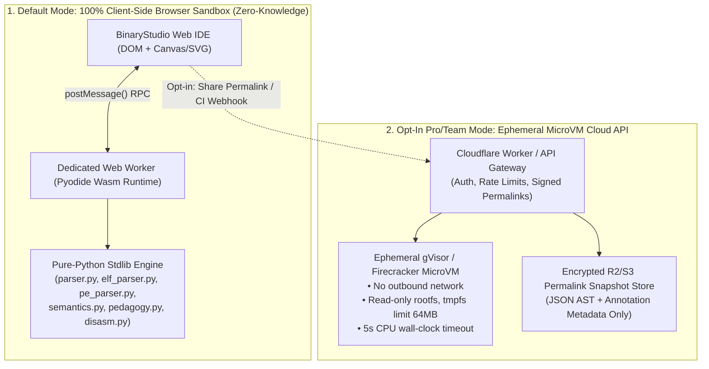

# Web Hosting, Zero-Trust Security & Monetization Blueprint (Future Sprint)

This document captures the architectural and product blueprint synthesized by the **Product Strategy** and **Systems Security** subagents for hosting **BinaryStudio** (`binary_viewer.py`) as a high-trust, multi-format (`Mach-O`, `ELF32/64`, `Windows PE32/PE32+`) web platform with sustainable monetization in a future sprint.

---

## 1. Threat Model & Zero-Trust Web Hosting Architecture

When hosting a binary analysis tool on the public web, users upload potentially untrusted or malicious binaries (malware samples, packed executables, malformed fuzzing inputs) **and** deeply confidential proprietary binaries (unreleased firmware, enterprise builds, security patches).

### 1.1 Dual-Mode Execution Model: Client-Side WebAssembly Default + Ephemeral Cloud Workers

#### Why BinaryStudio Is Uniquely Suited for WebAssembly (Pyodide)
Because the entire backend engine ([`backend/parser.py`](../backend/parser.py), [`backend/elf_parser.py`](../backend/elf_parser.py), [`backend/pe_parser.py`](../backend/pe_parser.py), [`backend/semantics.py`](../backend/semantics.py), [`backend/pedagogy.py`](../backend/pedagogy.py), [`backend/disasm.py`](../backend/disasm.py)) is written in **100% pure Python 3 Standard Library with zero native C extensions**, the entire `backend/` package can run directly inside a browser **Web Worker** via **Pyodide (CPython compiled to WebAssembly)**:
1. **Zero Data Exfiltration ("Local-Only Privacy Badge"):** By default, dragged-and-dropped binaries never leave the user's browser tab. Enterprise engineers and security researchers can inspect proprietary binaries without violating corporate data-governance policies.
2. **Zero Server Compute Cost for Free Tier:** Because parsing, entropy calculation, disassembly, and search run on the client's CPU inside a WebAssembly sandbox, serving 100,000+ monthly active free users costs only static CDN bandwidth (Cloudflare Pages / Vercel / S3).
3. **Complete Immunity to Server-Side RCE:** Even if a user drops an adversarial binary, it is parsed strictly as passive `bytes` inside a browser Wasm linear-memory sandbox with no OS syscall access.

---

### 1.2 Hardening the Cloud API Tier (For Shared Permalinks & CI/CD Webhooks)
When users opt into cloud features (saving shareable permalinks, team workspaces, or automated CI/CD binary posture checks), the cloud backend enforces five defense-in-depth controls:
1. **Disable Local Path Resolution in Web Mode (`--web-mode`):**
   - Disable `GET/POST /api/parse?path=...` for arbitrary server filesystem paths (restricting `/api/presets` strictly to an immutable allowlist of synthetic educational fixtures).
   - Disable subprocess shelling out to `/usr/bin/c++filt`, `/usr/bin/otool`, or `llvm-objdump`, relying exclusively on the built-in pure-Python demangler and pure-Python ARM64 / x86_64 decoders in [`backend/disasm.py`](../backend/disasm.py).
2. **Strict Resource Quotas & Parser Budgets:**
   - Enforce `MAX_UPLOAD_BYTES` (e.g., 25 MB for Free permalinks, 250 MB for Pro/Team), `MAX_SECTIONS = 256`, `MAX_SYMBOLS = 25,000`, and cycle-safe `visited` sets on Mach-O Exports Tries and PE RVAs.
3. **Ephemeral Sandboxed Execution:**
   - Run cloud parsing inside stateless **Firecracker microVMs** or **gVisor (`runsc`)** containers with `--network=none`, `--read-only`, `seccomp` syscall filtering, and a 5-second CPU timeout.
4. **Strict Content-Security-Policy (CSP) & Cross-Origin Isolation:**
   - Serve the Web IDE with `Content-Security-Policy: default-src 'self'; script-src 'self' 'wasm-unsafe-eval'; object-src 'none'; frame-ancestors 'none'` and `Cross-Origin-Opener-Policy: same-origin`.

---

## 2. Viral Growth Loops & Shareable Value-Add Features

To grow organically among systems programmers, security researchers, CTF players, and university CS courses, the web platform should center on three high-utility workflows:

1. **"Godbolt for Binaries" Deep Permalinks (`/s/<short-id>#slice=0&node=dyld_info&off=0x1040`):**
   - One-click **"Share View"** serializes the current slice, active inspector tab, selected struct field, highlighted hex byte span, and user markdown note into a shareable URL or embeddable `<iframe>` card for technical blogs, GitHub PRs, and university lecture notes.
2. **Curated "Museum of Famous & Quirk Binaries" Gallery:**
   - SEO-indexed interactive gallery featuring annotated Mach-O, ELF, and PE specimens:
     - *Smallest 45-byte Linux ELF64 executable* (overlapping `Ehdr` and `Phdr`)
     - *97-byte Tiny PE executable* (folded MS-DOS + NT header)
     - *Apple Silicon `arm64e` PAC + Chained Fixups showcase*
     - *UPX-packed vs. Unpacked Entropy comparison*
     - *Windows PE32+ with Rich Header, Forwarded Exports & Authenticode*
3. **CI/CD Binary Security & Size Regression Diffing:**
   - Compare two builds (`v1.0` vs. `v1.1`) side-by-side to spot accidental `RWX` segments, missing `Full RELRO` / `DYNAMIC_BASE` / `CS_RUNTIME` flags, new high-risk entitlements, or `.text` / `__TEXT` size regressions.

---

## 3. Tiered SaaS & Educational Monetization Model

| Tier | Target Audience | Price Point | Included Capabilities |
| :--- | :--- | :--- | :--- |
| **Community / Explorer (Free)** | Students, CTF players, open-source developers | **$0 / forever** | • Unlimited **100% Client-Side (Wasm)** inspection of Mach-O, ELF32/64, and PE32/PE32+ files • Full access to the 6-Stage OS Loader Simulator, Rosetta Stone Matrix & Guided Learning Tours • Public shareable permalinks (up to 10 MB) |
| **BinaryStudio Pro** | Reverse engineers, malware analysts, mobile/desktop security auditors | **$19 / month** *(or $180 / year)* | • **Private Encrypted Cloud Workspaces** & unlisted/password-protected permalinks (up to 250 MB) • **Side-by-Side Binary Diffing** (compare headers, sections, entropy, symbols & security posture across two builds) • **Exportable Audit & Forensics Reports** (PDF / SARIF / JSON) & auto-generated **YARA / ImHex `.hexpat`** rules • Cloud PDB / `debuginfod` / `.dSYM` symbol server correlation |
| **Team & CI/CD Guard** | AppSec teams, embedded/firmware vendors, game studios | **$79 / seat / month** | • **GitHub Action / GitLab CI Binary Hardening Gate:** Automated PR checks enforcing 9-point Mach-O / ELF / PE security posture policies (failing builds if `PIE`, `RELRO`, `GUARD_CF`, or `CDHash` regress) • Collaborative team annotations on shared binaries • REST API keys (`10,000+` automated scans/month) + SSO/SAML |
| **Academic & Bootcamp License** | University Operating Systems, Compilers & Reverse Engineering courses | **$499 / semester / course** | • Custom **Instructor Guided Tour & Lab Builder** (professors upload custom ELF/PE/Mach-O lab binaries with autograded micro-challenges) • LMS (Canvas / Gradescope) completion export |

---

## 4. Implementation Roadmap for the Hosting Sprint

1. **Phase 1 — Client-Side Wasm Bundle (`static/wasm-worker.js`):**
   - Package `backend/*.py` into an in-browser Pyodide Web Worker so **BinaryStudio** can be deployed as a static site on Cloudflare Pages / GitHub Pages with zero backend servers required.
2. **Phase 2 — URL Hash Deep-Linking & Exportable Reports:**
   - Sync `state.activeSliceIndex`, `state.selectedNodeId`, and `state.cursorOffset` with `window.location.hash` and add 1-click Markdown/JSON Security Scorecard export.
3. **Phase 3 — Cloud Permalink API & CI/CD Hardening Action:**
   - Add `--web-mode` flag to `backend/server.py`, containerize with `Dockerfile` + `seccomp` profile, and publish the `binarystudio-security-gate` GitHub Action.
