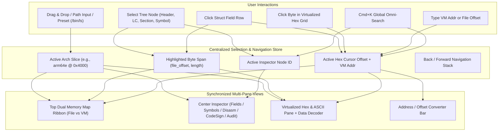

# BinaryStudio — UI/UX & Frontend Architecture Specification

**Document Status:** Proposed Architecture & Interaction Specification  
**Author:** Principal UI/UX Designer & Frontend/GUI Architect  
**Project Name:** **BinaryStudio** (`binary_viewer.py` / `macho_viewer.py`)  
**Design Inspiration:** MachOView, ImHex, PE-bear, DIE, Binary Ninja, Xcode Instruments

---

## 1. Design Philosophy & Visual Language

Reverse engineering and low-level binary inspection tools fail when they either dump unformatted text (`otool`/`nm` output) or bury byte-level ground truth behind opaque abstractions. **BinaryStudio** is built around **four core principles**:

1. **Ground-Truth Byte Traceability:** Every parsed field, load command, symbol, string, or entitlement has a concrete **File Offset (`fileoff`)**, **Byte Length (`size`)**, and (when mapped) **Virtual Memory Address (`vmaddr`)**. Clicking any high-level construct immediately reveals and highlights its exact backing bytes; clicking any byte in the hex view immediately resolves the deepest structural field, section, or symbol that owns it.
2. **High-Density, Zero-Clutter Typography:**
   - **Tabular Monospace Everywhere for Data:** `JetBrains Mono`, `SF Mono`, or `Fira Code` (`font-variant-numeric: tabular-nums`) at `12px`/`13px` with tight `22px` row height in tables and hex views so hundreds of rows are visible without scrolling.
   - **Proportional UI Chrome:** `Inter` or `-apple-system` (`SF Pro Text`) at `11px`–`13px` for section headers, badges, tabs, and filter pills.
3. **High-Contrast Dark Theme with Semantic Color Coding:**
   - **Canvas & Surfaces:**
     - Primary Background (Canvas): `#0D1117`
     - Elevated Panel / Sidebar: `#131820`
     - Active / Hover Row Surface: `#1C2430`
     - Selected / Pinned Row Surface: `#1F324D` (with `#388BFD` `2px` left accent border)
     - Subtle Hairline Borders: `#21262D` (`1px solid`)
   - **Semantic Memory Permission & Structural Colors:**
     - `R-X` / Executable (`__TEXT`): **Cyan/Blue** (`#388BFD` / `#58A6FF`, fill `rgba(56, 139, 253, 0.18)`)
     - `RW-` / Writable Data (`__DATA`): **Amber/Orange** (`#D29922` / `#E3B341`, fill `rgba(210, 153, 34, 0.18)`)
     - `R--` / Read-Only / Const (`__DATA_CONST`, `__LINKEDIT`): **Emerald/Teal** (`#2EA043` / `#3FB950`, fill `rgba(46, 160, 67, 0.18)`)
     - `---` / Guard Page (`__PAGEZERO`): **Muted Slate Hatching** (`#484F58` diagonal stripes)
     - Header & Load Commands (`mach_header_64`, `load_command`): **Purple/Violet** (`#A371F7`)
     - Code Signature & Security (`LC_CODE_SIGNATURE`, Entitlements): **Magenta/Pink** (`#F778BA`)
     - Warnings / Suspicious Anomalies (`RWX` segments, restricted entitlements, unaligned offsets): **Crimson Red** (`#F85149`)
4. **Instant Responsiveness via Virtualization & On-Demand Slicing:**
   - System binaries, Xcode frameworks, and dyld shared cache slices can range from 50 KB to 200+ MB. Both the **Hex/ASCII Pane** and **Symbol/String Tables** use strict viewport virtualization (`O(1)` DOM nodes rendered, ~40–60 rows mounted at any time) backed by chunked range queries or zero-copy `ArrayBuffer` slices.

---

## 2. Overall Layout & Information Architecture

The application uses a **full-viewport (`100vw x 100vh`, `overflow: hidden`) desktop-class multi-pane IDE layout** with draggable splitters and keyboard-toggled panes.

```
+--------------------------------------------------------------------------------------------------+
| [File Drop / Open] [Presets: /bin/ls | /usr/bin/true | Fat Binary]   [Arch: arm64e v] [Cmd+K 🔍] | <- Top Global Header (40px)
+--------------------------------------------------------------------------------------------------+
| [Mode: Log/Prop] [File Layout: |Hdr|__TEXT       |__DATA_CONST|__DATA|__LINKEDIT     |]          | <- Visual Memory Map Ribbon (64px)
|                  [VM Layout:   |__PAGEZERO (4GB)|__TEXT       |__DATA_CONST|__DATA|__LINKEDIT|]  |
+--------------------------------------------------------------------------------------------------+
| [Addr/Offset Converter:  File: 0x00003f40  <->  VM: 0x100003f40  ->  __TEXT,__text (_main+0x14)] | <- Converter & Breadcrumb Bar (32px)
+-----------------------+------------------------------------------+-------------------------------+
| LEFT SIDEBAR          | CENTER INSPECTOR PANE                    | RIGHT / BOTTOM SPLIT PANE     |
| Structure Tree (280px)| Context-Sensitive Detail View (Flex 1)   | Synchronized Hex & ASCII      |
|                       |                                          | (460px right or 280px bottom) |
| [Filter tree...     ] | [Tab: Fields] [Raw Struct] [Notes]       |                               |
| v Fat Header (2 arch) | +--------------------------------------+ | Offset    00 01 02 03 ...  ASCII|
|   o x86_64            | | Off  | Bytes    | Field   | Value    | | 00000000  CF FA ED FE ...  .... |
|   v arm64e (Active)   | |------+----------+---------+----------| | 00000010  0C 00 00 01 ...  .... |
|     o Mach64 Header   | | 0x00 | CF FA..  | magic   | MH_MAGIC | | 00000020 [19 00 00 00 ...  ....]|
|     v Load Commands   | | 0x04 | 0C 00..  | cputype | ARM64    | | ...                           |
|       o LC_SEGMENT_64 | | 0x08 | 02 00..  | cpusub  | ARM64E   | +-------------------------------+
|       o LC_SYMTAB     | | 0x0C | 02 00..  | filetype| EXECUTE  | | BYTE INSPECTOR / DATA DECODER |
|       o LC_DYLD_INFO  | | 0x10 | 14 00..  | ncmds   | 20       | | Cursor: 0x00000020 (VM: 0x1..)|
|     v Segments (5)    | | 0x18 | 85 00..  | flags   | PIE|DYLD | | Owner:  LC_SEGMENT_64 (__TEXT)|
|       v __TEXT (R-X)  | |      |  +- 0x01 | MH_NOUNDEFS        | | uint8: 25    uint32le: 0x19   |
|         o __text      | |      |  +- 0x20 | MH_DYLDLINK        | | uint64le: 0x0000001900000048  |
|         o __stubs     | |      |  +- 0x200000 | MH_PIE         | | ARM64 Insn: b #0x100003f40    |
|         o __cstring   | +--------------------------------------+ +-------------------------------+
|     o Symbol Table    |                                                                          |
|     o Dynamic Symbols |                                                                          |
|     o Strings         |                                                                          |
|     o Code Signature  |                                                                          |
|     o Security Audit  |                                                                          |
+-----------------------+--------------------------------------------------------------------------+
| Status: Ready | File: /bin/ls (168.4 KB) | SHA-256: 8a3f... | Endian: Little | Selection: 4B     | <- Status Bar (24px)
+--------------------------------------------------------------------------------------------------+
```

### 2.1 Left Sidebar: Hierarchical Tree Navigator
Inspired by MachOView's tree hierarchy, upgraded with instant inline search, badge counts, and offset previews:
- **Architecture Switcher (Fat / Universal Binaries):**
  - If the file begins with `FAT_MAGIC` / `FAT_CIGAM` (`0xCAFEBABE`), the root node displays `Universal Binary (N Architectures)` with child nodes for each slice (`x86_64`, `arm64`, `arm64e`), showing slice offset and size. Users can switch active slice from either the tree or a prominent top-bar dropdown.
- **Canonical Node Hierarchy per Mach-O Slice:**
  1. **Overview & Security Summary** (Dashboard card view: binary type, UUID, min OS version, SDK, PIE/ARC/Canary/CodeSign status)
  2. **Mach-O Header** (`mach_header` / `mach_header_64` — `0xFEEDFACE` / `0xFEEDFACF`)
  3. **Load Commands (`ncmds`)** — expandable list showing index `#0`..`#N`, command name (`LC_SEGMENT_64`, `LC_DYLD_CHAINED_FIXUPS`, `LC_MAIN`, `LC_UUID`, `LC_BUILD_VERSION`, `LC_LOAD_DYLIB`, `LC_RPATH`, etc.), and target summary (e.g., `__TEXT`, `/usr/lib/libSystem.B.dylib`).
  4. **Segments & Sections** — grouped by `LC_SEGMENT_64`, with permission badges (`R-X`, `RW-`, `R--`) and expandable child sections (`__TEXT,__text`, `__TEXT,__stubs`, `__TEXT,__cstring`, `__DATA_CONST,__got`, `__DATA,__la_symbol_ptr`, etc.).
  5. **Dyld Info & Fixups** — Rebase opcodes, Binding info, Weak/Lazy binds, Export Trie (`LC_DYLD_INFO_ONLY` / `LC_DYLD_EXPORTS_TRIE` / `LC_DYLD_CHAINED_FIXUPS`).
  6. **Symbol Tables**
     - Symbol Table (`LC_SYMTAB` — local, external, undefined symbols)
     - Dynamic Symbol Table (`LC_DYSYMTAB` — indirect symbol table, stub mappings)
  7. **String Tables & Literals**
     - String Table (`LC_SYMTAB` string pool)
     - C-String Literals (`__TEXT,__cstring`, `__TEXT,__objc_methname`, `__TEXT,__objc_classname`)
  8. **Objective-C / Swift Metadata** (if present — Classes, Protocols, Selectors, Swift Type Descriptors)
  9. **Code Signature & Entitlements (`LC_CODE_SIGNATURE`)**
     - SuperBlob (`CSMAGIC_EMBEDDED_SIGNATURE`)
     - CodeDirectory (CDHash, Team ID, Identifier, Special & Code Slot hashes)
     - Entitlements (`CSMAGIC_EMBEDDED_ENTITLEMENTS` XML/plist & DER view)
     - CMS Signature / Certificate Chain
  10. **Security & Hardening Audit** — Automated check checklist (PIE, Stack Canary, ARC, Stripped Symbols, `@rpath` / relative dylib hijacking risks, `RWX` segments, dangerous entitlements like `get-task-allow` or `com.apple.private.*`).

### 2.2 Top Visual Memory Map Bar (Dual Ribbon)
A signature visual feature inspired by Binary Ninja's memory map and ImHex's data visualizer:
- **Dual Synchronized Ribbons (64px height total):**
  1. **File Offset Ribbon (Top Track):** Shows physical layout from `0x0` to `filesize` (`Mach Header + Load Commands` -> `__TEXT` -> `__DATA_CONST` -> `__DATA` -> `__LINKEDIT`). Unmapped file gaps are highlighted in dark grey.
  2. **Virtual Memory Ribbon (Bottom Track):** Shows mapped virtual address space (`__PAGEZERO` (`0x0`–`0x100000000`) -> `__TEXT` -> `__DATA_CONST` -> `__DATA` -> `__LINKEDIT`).
- **Scale Toggle (`Logarithmic / Sqrt` vs `Linear Proportional`):**
  - Because `__PAGEZERO` is 4 GB (`0x100000000` bytes) while `__TEXT` may be 64 KB, a strict linear scale would crush all segments into a 1px sliver. By default, the ribbon uses a **Square-Root / Compressed Scale** (with clear break markers `//` on `__PAGEZERO`) so every segment and section is legible and clickable, with a toggle button for true linear scale (excluding `__PAGEZERO`).
- **Interactive Hover & Selection:**
  - Hovering over any segment block displays a rich floating tooltip: Segment Name, File Range (`0x0000`–`0x4000`), VM Range (`0x100000000`–`0x100004000`), Size (`16 KB`), Initial/Max Protection (`R-X / R-X`), and Section count.
  - Clicking a block selects that segment in the Left Tree, opens its section breakdown in the Center Inspector, and scrolls the Hex View to its starting offset.
  - A **live vertical playhead marker** (`#58A6FF` glowing line) tracks the currently selected byte/offset in real time across both tracks.

### 2.3 Center Inspector Pane (Context-Sensitive Multi-Mode View)
Depending on the active node in the Left Sidebar, the Center Inspector adapts its primary view while maintaining a consistent top header (showing Title, File Offset Range, VM Address Range, Size, and a "Jump to Hex" button):

1. **Structure Field Table View** (Default for Headers, Load Commands, Segment/Section headers, SuperBlobs):
   - Columns:
     - `File Offset` (e.g., `+0x00000018`, toggleable between absolute `0x...` and struct-relative `+0x...`)
     - `Raw Bytes` (e.g., `85 00 20 00`)
     - `Type / Size` (e.g., `uint32_t`)
     - `Field Name` (e.g., `flags`)
     - `Parsed Value` (e.g., `0x00200085`)
     - `Decoded Meaning / Description` (e.g., expandable bitmask pills: `MH_NOUNDEFS (0x1)`, `MH_DYLDLINK (0x4)`, `MH_TWOLEVEL (0x80)`, `MH_PIE (0x200000)`).
   - **Bitfield & Enum Expansion:** Fields containing bitmasks (`mach_header.flags`, `section_64.flags`, `vm_prot_t`) can be expanded inline or hovered to inspect individual bit flags (set bits in green/blue, unset bits dimmed).
   - **Cross-Reference Links (`->`):** Fields that represent file offsets or VM addresses (such as `symoff`, `stroff`, `dataoff`, `entryoff`, or section `offset`/`addr`) render a clickable jump chip (`[Jump -> 0x00008400]`) that navigates directly to the target structure or hex range.

2. **Symbol & String Table View** (For `LC_SYMTAB`, `LC_DYSYMTAB`, Exports, Imports, C-Strings):
   - High-speed virtualized data grid with instant multi-column filtering:
     - **Filter Bar:** Search substring/regex, filter by Symbol Type (`SECT`, `UNDF`, `ABS`, `PBUD`), Visibility (`EXT`, `PEXT`, `LOCAL`), or Target Library (`libSystem.B.dylib`, `Foundation`, etc.), plus a **Demangle C++/Swift Symbols** toggle button.
     - **Columns (Symbols):** `# Index`, `File Offset`, `VM Address (n_value)`, `Type Badges`, `Section`, `Library Ordinal`, `Symbol Name (Raw / Demangled)`.
     - **Columns (Strings):** `# Index`, `File Offset`, `VM Address`, `Length`, `Encoding (ASCII/UTF-8)`, `String Literal` (with escaped control characters highlighted).

3. **Disassembly & Section Preview View** (For executable sections like `__TEXT,__text`, `__TEXT,__stubs`):
   - Linear disassembly table (powered by Capstone on backend or lightweight ARM64/x86_64 decoder):
     - Columns: `File Offset`, `VM Address`, `Raw Instruction Bytes`, `Mnemonic`, `Operands`, `Resolved Symbol / Comment` (e.g., `; -> imp___stubs__printf` or `; literal: "Hello World"`).
   - Clicking any instruction highlights its 4 bytes (ARM64) or variable bytes (x86_64) in the synchronized Hex Pane.

4. **Code Signature & Entitlements View** (`LC_CODE_SIGNATURE`):
   - **Sub-tabs:**
     - `SuperBlob Structure`: Interactive table of `CS_SuperBlob` and `CS_BlobIndex` entries.
     - `CodeDirectory`: Parsed security parameters (Version, Flags like `CS_ADHOC` / `CS_RUNTIME` (Hardened Runtime), Hash Type `SHA-256`, Page Size `4096 B`, Identifier, Team ID, CDHash, Special Slot hashes for `Info.plist`, Requirements, ResourceDir, Entitlements).
     - `Entitlements (XML / DER)`: Syntax-highlighted XML plist viewer alongside a structured Key-Value security table that flags high-privilege entitlements (e.g., `com.apple.security.cs.allow-jit`, `com.apple.security.get-task-allow`, `com.apple.private.security.no-sandbox`).

5. **Security & Hardening Audit View**:
   - Executive security scorecard (`Pass` / `Warn` / `Info`) checking:
     - **PIE (`MH_PIE`)**: Position Independent Executable enabled?
     - **Stack Smashing Protection (`___stack_chk_fail` / `___stack_chk_guard`)**: Imported/present?
     - **Automatic Reference Counting (`_objc_release` / `_objc_retain`)**: Present if ObjC used?
     - **Restricted Segment / Section (`__RESTRICT,__restrict`)**: Protects against `DYLD_INSERT_LIBRARIES`?
     - **RPATH & Dylib Hygiene**: Checks for relative `@rpath` / `@executable_path` / `@loader_path` and weak dylibs.
     - **Memory Permissions**: Flags any segment or section with `RWX` (Read+Write+Execute) permissions.
     - **Code Signature Integrity**: Ad-hoc vs Developer ID vs Apple System signed, Hardened Runtime status.

### 2.4 Synchronized Interactive Hex & ASCII Pane
Dockable to either the **Right Split** (ideal for wide monitors, 16 bytes per row) or **Bottom Split** (supporting 16 or 32 bytes per row):
- **Three-Column Virtualized Layout:**
  1. `Offset Column`: Toggleable between File Offset (`0x00003F40`) and Virtual Address (`0x100003F40`).
  2. `Hex Bytes Grid`: 16 bytes per row (`00 01 02 03 04 05 06 07  08 09 0A 0B 0C 0D 0E 0F`), extra gap between byte 7 and 8. Null bytes (`00`) are subtly dimmed (`#484F58`) so non-zero payloads pop visually; ASCII printable bytes (`0x20`–`0x7E`) have a subtle tint.
  3. `ASCII Column`: 16 characters per row; non-printable bytes rendered as muted `.` (`#484F58`), printable characters in crisp `#E6EDF3`.
- **Bidirectional Selection & Structural Highlighting:**
  - **Inspector -> Hex:** Clicking a row in the Structure Field Table (e.g., `mach_header_64.cputype` at `0x04..0x08`), a Load Command, or a Symbol highlights the parent structure's full range in a soft translucent tint (`rgba(56, 139, 253, 0.12)`) and the active field's exact bytes (`0x04..0x07`) in a high-contrast solid box (`rgba(56, 139, 253, 0.45)` with `#58A6FF` border), automatically scrolling the hex viewport to center those bytes.
  - **Hex -> Inspector ("Reverse Lookup"):** Clicking any byte in the Hex View updates the **Byte Inspector / Data Decoder Footer** at the bottom of the Hex Pane AND shows a breadcrumb of every overlapping structure containing that byte (e.g., `Arm64 Slice -> LC_SEGMENT_64 (__TEXT) -> Section __text -> _main (+0x14)`), with a one-click button to focus that node in the Center Inspector.
- **Live Data Inspector Card (Docked below Hex Grid):**
  - Displays live decoding of the 1–8 bytes starting at the selected cursor offset (with Little-Endian / Big-Endian toggle):
    - `int8 / uint8`, `int16 / uint16`, `int32 / uint32`, `int64 / uint64`
    - `float32 / float64`
    - `SLEB128 / ULEB128` (crucial for Mach-O dyld opcodes & export tries!)
    - `Null-terminated String preview`
    - `ARM64 Instruction preview` (4-byte little-endian decode)

---

## 3. Interactive UX & Power-User Workflows

### 3.1 Real-Time Address / Offset Converter Bar
Always accessible in the secondary toolbar directly below the Memory Map Ribbon:
- **Dual Linked Inputs + Resolved Target Pill:**
  - `[File Offset: 0x00003f40]` `<->` `[VM Address: 0x100003f40]` `<->` `[RVA: +0x00003f40]`
  - Typing into **any** box (in hex `0x3f40` or decimal `16192`) immediately computes the others using the active slice's `LC_SEGMENT_64` mappings (`vmaddr - fileoff + offset`).
  - Displays the **Resolved Context Badge** next to the inputs:
    - Segment & Section: `__TEXT,__text` (`R-X`)
    - Nearest Symbol: `_main + 0x14`
    - Action Buttons: `[Jump to Hex]` `[Jump to Section]` `[Copy Info]`
  - If an address falls inside `__PAGEZERO` or unmapped padding between segments, it clearly badges `Unmapped in File (Zero-filled VM)` or `File-Only (Unmapped in VM)`.

### 3.2 Global Command Palette & Omni-Search (`Cmd+K` / `/`)
Pressing `Cmd+K` (or clicking the search bar in the top header) opens a modal spotlight overlay searching across all parsed artifacts in `<15ms`:
- **Prefix Scopes & Tabs:**
  - `All` (ranked matches across symbols, strings, load commands, sections)
  - `@` — **Symbols** (fuzzy match raw or demangled names, e.g., `@objc_msgSend`, `@main`)
  - `"` — **Strings** (search C-strings and ObjC selector names, e.g., `"usage:`, `"/usr/lib`)
  - `#` — **Load Commands & Sections** (e.g., `#LC_MAIN`, `#__cstring`)
  - `0x` — **Address / Offset / Hex Bytes** (typing `0x100003f40` jumps to that VM address; typing spaced hex bytes like `CF FA ED FE` or `FD 7B BF A9` searches raw binary bytes for matching sequences!).
- Keyboard navigation (`Up`/`Down` arrows preview the match in the background; `Enter` commits selection and closes palette).

### 3.3 Frictionless File Loading & Built-In Presets
To guarantee zero-friction verification and instant utility upon opening the app:
1. **Drag-and-Drop Anywhere:** Dragging any binary file (executable, `.dylib`, `.bundle`, `.o`, `.kext`) onto the window displays a full-window dropzone overlay and loads the file immediately.
2. **Local Filesystem Path Input & Browser:**
   - Users can either pick a local file via the native file picker OR type/paste any absolute macOS path (e.g., `/System/Applications/Calculator.app/Contents/MacOS/Calculator` or `/usr/lib/dyld`) directly into the "Open Path" bar for direct server-side disk reading.
3. **One-Click Built-In Sample Presets (Top Header Bar):**
   - Immediately visible in the header bar and empty-state welcome screen:
     - **`/bin/ls`** — Real macOS Universal (`x86_64` + `arm64e`) system utility with rich imports, symbols, C-strings, and Apple system code signature.
     - **`/usr/bin/true`** — Minimal Universal Mach-O executable, great for clean structural inspection.
     - **`Synthetic Fat / Multi-Feature Test Binary`** — Pre-generated fixture containing custom entitlements, ObjC metadata, exported symbols, chained fixups, and security edge cases so every single UI tab is guaranteed to have rich data even in sandboxed environments.
4. **History & Bookmarks:** Pin offsets/addresses with custom labels (`B` hotkey) and switch between recently inspected binaries without losing scroll or selection state.

### 3.4 Keyboard Shortcuts (Power-User Ergonomics)
| Shortcut | Action |
| :--- | :--- |
| `Cmd + K` or `/` | Open Global Search / Jump Palette |
| `G` | Focus Address / Offset Converter Input |
| `Space` | Toggle Hex Pane Layout (Right Split vs Bottom Split vs Maximized) |
| `[` / `]` | Navigate Back / Forward in Selection & Jump History |
| `H` | Toggle Hex Offset Column between `File Offset` and `VM Address` |
| `1` / `2` / `3` | Switch Center Inspector Tabs (Structure / Hex Preview / Raw JSON) |

---

## 4. Technology Stack Options & Architectural Recommendation

We evaluated three candidate GUI architectures for building and delivering **BinaryStudio**:

### Option A: Local Python (FastAPI) Backend + Desktop-Class Web GUI (Single-Page App) + Native Window / Browser Launcher
- **Architecture:**
  - **Backend (`Python 3 + FastAPI`):** Handles local filesystem access (`/bin/ls`, arbitrary paths, uploaded files), zero-dependency or `lief`/`macholib`/custom struct-level Mach-O binary parsing (producing exact byte-offset AST nodes for every header, load command, section, symbol, string, code signature, and disassembly), and fast `/api/bytes` range endpoints.
  - **Frontend (Modern React/Vite or Pre-bundled Single-Page Application with Tailwind/Custom CSS):** High-density IDE interface with virtualized Hex Viewer, dual SVG/Canvas Memory Map Ribbon, interactive Structure Tree, live Address Converter, and `Cmd+K` omni-search.
  - **Launch Modes:** Runs on a local port (`http://127.0.0.1:8000`) with automatic browser launch (`--open`) or optional native macOS WebKit wrapper (`pywebview` / Chrome `--app` mode).
- **Pros:**
  - **Zero Build Friction & Instant Verification:** No 10 GB Xcode build toolchain lockups, code-signing prompts, or Swift compiler version mismatches. Automated tests (`pytest`, `curl`, headless browser / Playwright) and users can verify both the API and GUI in seconds.
  - **Superior High-Density Data Tables & Layout Flexibility:** CSS Grid/Flexbox, custom SVG memory maps, virtualized scrolling, and sticky headers allow pixel-perfect recreation of ImHex/Binary Ninja aesthetics.
  - **Direct Local Path Support:** Because the Python backend runs locally on the user's Mac, it can directly read `/bin/ls`, `/usr/bin/true`, or any path on disk without browser sandbox limitations, while also supporting browser drag-and-drop file uploads.
- **Cons:**
  - Requires keeping the lightweight local server process running while using the GUI.

### Option B: Native macOS App (Swift + SwiftUI / AppKit)
- **Architecture:** Native macOS `.app` bundle using `NavigationSplitView`, `NSTableView` for hex/symbols, and Swift `UnsafeRawBufferPointer` parsing.
- **Pros:** Native macOS menu bar integration and single `.app` binary distribution.
- **Cons:**
  - SwiftUI's `Table` and `LazyVStack` struggle severely with high-density 16-column interactive hex grids and bidirectional byte selection without dropping down to complex `NSViewRepresentable` / `NSTextView` custom drawing.
  - Automated headless verification, visual regression testing, and cross-environment reproducibility are significantly harder than a local Web + API architecture.

### Option C: Terminal TUI (`Textual` / `Rich` / `Cursive`)
- **Architecture:** Terminal-based split-pane interface.
- **Pros:** Runs inside any SSH or terminal session.
- **Cons:** Cannot render proportional/logarithmic graphical memory ribbons, smooth hover tooltips, or pixel-accurate multi-column tables at the density required by a modern MachOView/ImHex replacement.

### Recommendation: **Option A (Python FastAPI Backend + High-Density Desktop Web GUI)**

We strongly recommend **Option A** with a **strict contract between the Binary Parser Engine and the Frontend UI**:

1. **Self-Contained, Zero-Friction Delivery:**
   - The backend serves both the REST/JSON inspection API and the static frontend assets from a single command (`python3 binary_viewer.py`).
   - Supporting both **server-side path loading** (`/api/load-path` for `/bin/ls`, `/usr/bin/true`, or any local path) and **drag-and-drop binary upload** (`/api/upload`) gives users the best of native disk access and web ergonomics.
2. **Exact Byte-Range AST Contract (`Span` Model):**
   - Every parsed structure returned by the backend includes a standardized `span` descriptor:
     ```json
     {
       "id": "lc_0_seg_text",
       "label": "LC_SEGMENT_64 (__TEXT)",
       "file_offset": 32,
       "byte_size": 712,
       "vm_address": 4294967296,
       "vm_size": 16384,
       "permissions": "r-x",
       "fields": [
         {
           "name": "cmd",
           "file_offset": 32,
           "byte_size": 4,
           "raw_hex": "19 00 00 00",
           "type": "uint32",
           "value": "0x19",
           "decoded": "LC_SEGMENT_64",
           "description": "Defines a 64-bit segment of this file to be mapped into the address space"
         }
       ]
     }
     ```
   - This unified `file_offset` + `byte_size` contract powers:
     1. The **Left Sidebar Tree**
     2. The **Top Visual Memory Map Ribbon**
     3. The **Center Structure Field Inspector**
     4. The **Synchronized Hex & ASCII Highlighter**
     5. The **Reverse Byte-to-Structure Interval Index** (an interval tree on the frontend that resolves any clicked byte `offset` to its owning Segment, Section, Load Command, Struct Field, or Symbol in `O(log N)` time).

---

## 5. Component & State Architecture Summary



---

## 6. Verification & Acceptance Checklist for UI Implementation

- [ ] **Preset Instant Load:** Clicking `/bin/ls`, `/usr/bin/true`, or the synthetic test preset loads the full hierarchy, memory map, structure fields, and hex bytes in `<300ms`.
- [ ] **Fat Binary Slice Switching:** Loading a universal binary displays all architecture slices (`x86_64`, `arm64`/`arm64e`) and cleanly switches all panes when toggled.
- [ ] **Memory Map Interactivity:** Both File Layout and Virtual Memory Layout ribbons render with permission color-coding (`R-X`, `RW-`, `R--`), hover tooltips, scale toggle (Compressed vs Linear), and click-to-jump.
- [ ] **Bidirectional Hex Synchronization:**
  - Clicking any field in the Mach Header or Load Command table scrolls the Hex View to that offset and highlights the exact field bytes.
  - Clicking any byte in the Hex View updates the live Data Inspector (`uint8`..`uint64`, `ULEB128`, string, ARM64 instruction) and identifies the owning structure/section/symbol.
- [ ] **Address / Offset Converter:** Entering a VM address (e.g. `0x100003f40`) or file offset immediately computes the counterpart and displays the containing segment, section, and nearest symbol.
- [ ] **Global Search (`Cmd+K`):** Searching across symbols, strings, load commands, or hex byte sequences filters results instantaneously and navigates on selection.
- [ ] **Code Signature & Security Audit:** Dedicated views inspect `LC_CODE_SIGNATURE` blobs/entitlements and present an actionable binary hardening scorecard (PIE, Canary, ARC, RWX check, Restricted segment).
