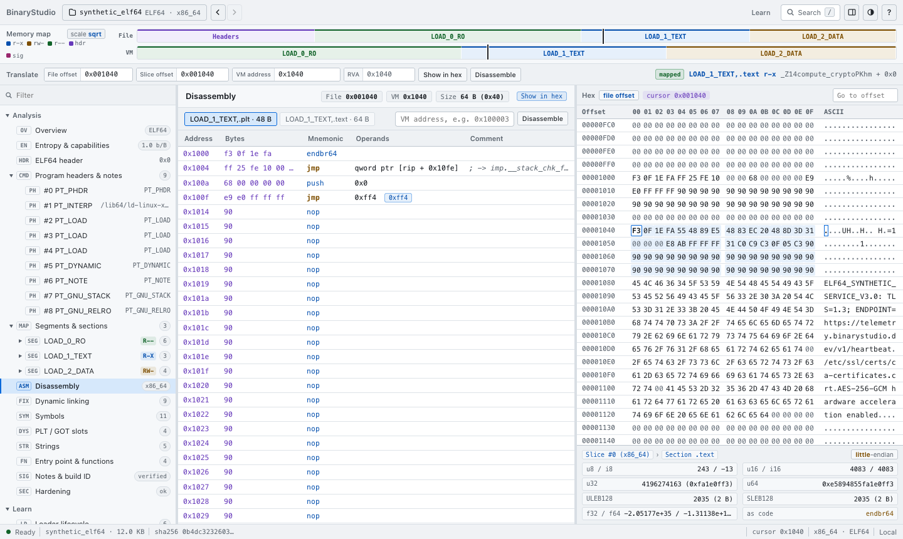
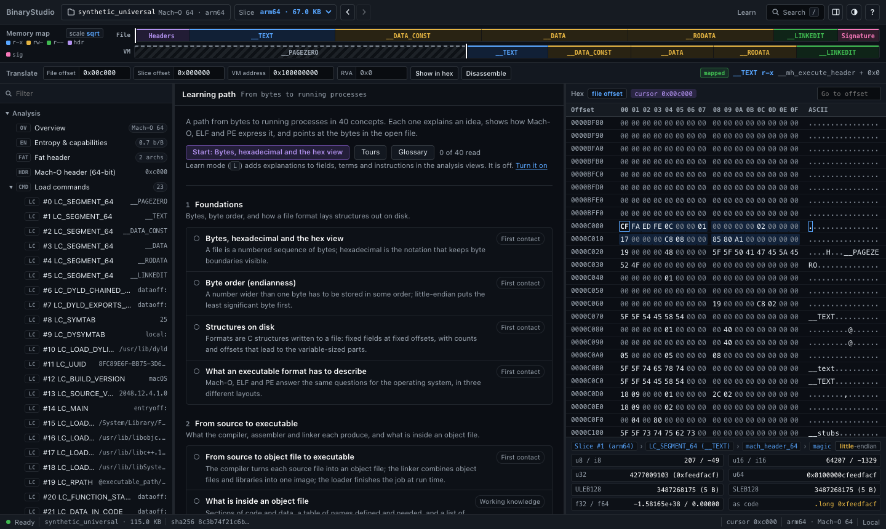
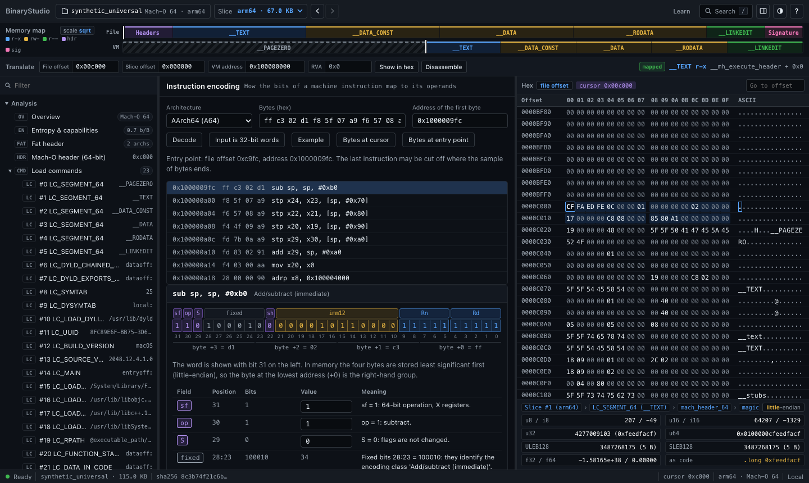

# User guide

This guide describes the web interface as it is in version 2.0.0. It applies to all three ways of running BinaryStudio (local server, public server, static build) except where a section says otherwise. Press `?` in the app for the keyboard reference generated from the commands that are actually registered; it is the authoritative list.

- [Opening a file](#opening-a-file)
- [The workspace](#the-workspace)
- [Navigation and links](#navigation-and-links)
- [Keyboard shortcuts](#keyboard-shortcuts)
- [Search and the command palette](#search-and-the-command-palette)
- [The address translator](#the-address-translator)
- [Disassembly](#disassembly)
- [What the analysis claims](#what-the-analysis-claims)
- [Learn](#learn)
- [Labs](#labs)
- [Limits you may meet](#limits-you-may-meet)

## Opening a file

Press `O` (or `Cmd/Ctrl+O`), use the document button at the left of the toolbar, or drop a file onto the window. The open panel lists the six bundled samples. In local mode it also offers `/bin/ls` and `/usr/bin/true` from your machine and lets you type a path to any file you can read.

In local mode a URL can also name a file on your machine, as `?file=/absolute/path` or `#doc=path:/absolute/path`. A path that arrives this way is not read straight away: the start view shows "Open `<path>`?" with **Open** and **Dismiss**, and nothing is read until you choose Open. Paths you typed into the open panel, the file given to `--file` on the command line, and a path you already confirmed in an earlier session open without asking. Other modes ignore paths altogether.

Where the file goes depends on how BinaryStudio is running:

| Mode | What happens to an opened file |
|---|---|
| Local (`python3 binary_viewer.py`) | Read by the Python process on your machine. |
| Public server (`--public`) | Uploaded to that server, analysed there in a separate worker process, held in memory under a random id, dropped after 30 minutes idle (default) or when the cache needs room. Never written to disk by BinaryStudio. |
| Static build | Analysed inside your browser tab by the same Python engine compiled to WebAssembly. Nothing is uploaded. |

If the server has dropped a document you still have open (it expired or the server restarted), the interface re-uploads it from the copy it keeps in the tab's memory and carries on. It keeps the bytes of the open document, and of up to two previous ones if they are 16 MiB or smaller. File bytes are never written to local storage or any other browser storage, so closing or reloading the tab discards them.

## The workspace



From top to bottom:

- **Toolbar.** The open document (click it to open another), back and forward, a slice picker for universal Mach-O files, the Learn mode switch, Search, the hex-pane dock toggle, the theme toggle and `?` for the keyboard reference.
- **Memory map.** Two ribbons: the file as it is on disk and the address space as the loader maps it, coloured by permission (`r-x`, `rw-`, `r--`, headers, signature). Hover a block for its numbers; click it to select it. `M` switches the scale between square-root (small regions stay visible) and linear.
- **Translate bar.** See [The address translator](#the-address-translator).
- **Structure tree** (left). The **Analysis** group holds the structures of the open file; **Learn** and **Labs** hold the feature views; **Help** holds the keyboard reference. Type in the filter box (`F`) to narrow it.
- **Inspector** (centre). The selected node: field tables with offsets, raw bytes and decoded meaning, or a feature view.
- **Hex view** (right, or bottom with `D`). Every byte of the file, with the selected structure tinted and the selected field outlined. The offset column shows file offsets or virtual addresses (`H`). Below it, a decoder shows the bytes at the cursor as 8/16/32/64-bit integers, LEB128, floats and one instruction; `E` toggles its byte order.
- **Status bar.** Readiness, file name and size, SHA-256, cursor position, slice and mode.

Selection runs both ways: choose a field and its bytes are highlighted; click a byte and the breadcrumb under the hex view lists every structure that contains it, outermost first.

The theme follows the operating system until you choose one (`T`, or "Use the system theme" in the palette). Pane sizes, dock side, theme, Learn mode and the last open sample or path are kept in the browser's local storage, under keys starting `binarystudio:`. An uploaded file's bytes and id are not.

When a parser hits one of its caps (for example more than 20,000 symbols in a slice), the slice carries a warning that names the limit and the real count, and the view is marked as truncated. The caps are listed in `ANALYSIS_LIMITS` in `backend/constants.py`.

## Navigation and links

`[` and `]` (or the browser's own buttons) move through the history of views you have opened. The URL hash records where you are:

```
#doc=preset:synthetic_elf64&slice=0&view=disassembly&off=0x1040
```

`doc` is honoured only for samples (`preset:...`) and, in local mode, for paths (`path:/absolute/path`); a path from a link is opened only after you confirm it (see [Opening a file](#opening-a-file)). An uploaded file is never put in a link, because its id is the only thing protecting it; a link copied while an upload is open restores the view but not the file. `P` copies a link to the current view.

Feature views take parameters as `p.<name>=<value>`, for example `#view=learn.glossary&p.t=<term id>`.

## Keyboard shortcuts

`Mod` is Cmd on macOS and Ctrl elsewhere. Single-key shortcuts do nothing while the focus is in a text field or a dialog is open.

| Keys | Action |
|---|---|
| `Mod+K` or `/` | Search and commands |
| `Mod+Shift+P` | Commands only |
| `O`, `Mod+O` | Open a binary |
| `?` | Keyboard reference |
| `T` | Toggle light / dark theme |
| `L` | Toggle Learn mode |
| `Shift+L` | Learning path |
| `Shift+K` | Glossary |
| `X` | Explain the selected instruction or the terms in this view (Learn mode) |
| `P` | Copy a link to this view |
| `[`, `]` | Back, forward |
| `1`, `2`, `3` | Focus the tree, the inspector, the hex view |
| `F` | Filter the structure tree |
| `G` | Translate an address |
| `Shift+G` | Go to a file offset |
| `A` | Disassemble at the cursor |
| `C`, `Shift+C`, `Alt+C` | Copy the selection as hex, the cursor's file offset, the cursor's virtual address |
| `H` | Hex offset column: file offset or virtual address |
| `E` | Decoder byte order |
| `D` | Dock the hex pane right or bottom |
| `M` | Memory map scale: square-root or linear |
| `I` | Labs: edit bytes in the hex view |
| `U` / `Mod+Z`, `Shift+U` / `Mod+Shift+Z` | Labs: undo, redo a patch |
| `V` | Labs: switch between the original and the patched copy |
| `.`, `,`, `4` | Tours: next step, previous step, focus the tour panel |

In the hex view the arrow keys, PageUp/PageDown and Home/End move the cursor, Shift extends the selection, and Enter or a double-click activates a byte (used by the patch lab). Alt+click (Option+click on macOS) copies the value under the pointer.

## Search and the command palette

`Mod+K` or `/` opens one box that searches views, commands and the open file. Prefixes narrow it:

| Prefix | Searches |
|---|---|
| `>` | Commands only |
| `@` | Symbols |
| `"` | Strings |
| `#` | Structures (headers, load commands, segments, sections) |
| `0x...` | Jump to that address |
| hex bytes, e.g. `cf fa ed fe` | Find that byte sequence |

Glossary terms, concepts and tours also appear once you have typed two characters. Searches of the file run on the engine (`GET /api/search`); a query is at most 256 characters and returns at most 200 results.

## The address translator

The translate bar holds four linked fields: **File offset** (from the start of the file), **Slice offset** (from the start of the selected slice of a universal file; equal to the file offset otherwise), **VM address** and **RVA** (the address relative to the image base, as PE uses). Type into any one and the others follow. The badge on the right says whether the address is `mapped`, and names the segment, section, permissions and nearest symbol. **Show in hex** moves the hex cursor there; **Disassemble** opens the disassembly at that address.

Addresses inside zero-fill regions (`__PAGEZERO`, `.bss`, the tail of a segment whose memory size exceeds its file size) have no file offset, and the translator says so rather than inventing one. The same lookup is available from the command line with `--cli FILE --translate VALUE`.

## Disassembly

The **Disassembly** node lists instructions from the entry point, or from any address you give. Each row shows the address, the bytes, the instruction in Intel syntax (x86) or standard A64 syntax, and a comment with what the listing could resolve: the symbol or import a branch reaches, the string an `adrp`/`add` pair or a RIP-relative operand points at.

One decoder serves the listing, the CLI and the encoding lab: the tables in `backend/labs_encoding.py`. The tests compare it with `llvm-objdump` (see [CONTRIBUTING.md](../CONTRIBUTING.md#disassembler-checks)). What it does not decode is shown as data, never as a guessed instruction:

- **AArch64:** a word outside the tables is shown as `.long 0x...` with its encoding group (for example "Advanced SIMD / floating-point", "SVE").
- **x86 / x86-64:** VEX and EVEX encodings, the `0F 38` and `0F 3A` opcode maps and x87 are not decoded. Their length is still known, so each becomes a single `.byte` row of the right size and the listing stays in step. Any other unknown opcode is shown as one `.byte`, and the rows after it are a best guess until the next symbol or function start; the comment says so.
- Mach-O `LC_DATA_IN_CODE` ranges (jump tables inside `__text`) are shown as `.byte`, `.short` or `.long`.

In local mode, x86 code of a file on disk is listed by `llvm-objdump` or `objdump` when one is installed, and by the built-in decoder otherwise; public mode and the static build always use the built-in decoder.

Only x86 (32 and 64-bit) and AArch64 are disassembled. For every other architecture, including 32-bit ARM and Thumb, RISC-V, PowerPC and MIPS, the Disassembly view shows no listing and says why: "This file is for ..., which BinaryStudio does not disassemble." The bytes are still in the hex view, and the parsers read the headers, segments, symbols and the rest of such files as usual.

## What the analysis claims

The **Hardening** view, the signature view (**Code signature** for Mach-O, **Authenticode** for PE, **Notes & build ID** for ELF), the import tables and the capabilities panel state facts read from the file. Each check's detail text says what was read; these are the points most often misread.

- **No signature is validated.** For Mach-O, the code-page hashes are recomputed and compared with the CodeDirectory; the CMS signature and certificate chain are not evaluated. For PE, the view reports the Authenticode image hash of the file and whether the certificate table contains that hash. A match means the signed content is this file's content. The signature over the hash and the certificate chain are not evaluated, and the name shown is the first certificate in the table, which need not be the signer. A PE without a certificate table may still be catalog-signed, which cannot be seen from the file.
- **ELF is never shown as signed.** ELF defines no embedded signature. A GNU build ID identifies a build; it is not a signature and is shown as an identifier, with the file's notes, in place of signature details.
- **ELF imports name a library only when the file records one.** ELF does not say which library provides an undefined symbol. The one place a file ties a symbol to a library is symbol versioning (`.gnu.version` and `.gnu.version_r`), so an import with a version is attributed to the library that version came from, and any other import is shown as "not recorded in the file" rather than assigned to a guessed library.
- **PIE (Mach-O).** `MH_PIE` is judged only for main executables (`MH_EXECUTE`). For dylibs, bundles, object files, dyld and kernel or firmware images the check says "Not applicable".
- **Writable and executable memory.** For Mach-O the check fails only when a segment's initial protection (`initprot`) has both write and execute, or the header asks for an executable stack. Both bits in `maxprot` alone are reported as a note, not a failure. Object files are not judged.
- **DEP (PE).** A missing `NX_COMPAT` flag fails only on 32-bit x86 (i386) images. Other machines always run with DEP, so there it is informational.
- **SafeSEH (PE).** Judged only on 32-bit x86. Other machines use table-based exception handling, and the check says "Not applicable".
- **Control Flow Guard (PE).** A pass needs evidence in the load configuration directory (the instrumented flag and a non-empty table of valid call targets), not just the `GUARD_CF` header flag. The flag without that evidence is a warning: "Declared in the header, but not instrumented".
- **Stripped (PE).** A PE is called stripped when it has no COFF symbol table. Debug information normally lives outside the image, in a PDB that the debug directory names.
- **Capabilities.** A capability (networking, process execution, cryptography and so on) is reported when an import, a defined symbol or an entitlement matches an API name exactly: whole names, never substrings, so `GetSystemInfo` is not `system`. An API name that only appears as a string in the file is listed separately as weak evidence; it is how names passed to `dlsym` or `GetProcAddress` look, but also how ordinary text looks.

The PE32+ sample is built to exercise these views: its header checksum is correct, and it carries a structurally complete Authenticode signature whose hash matches the file. The signature was made with a throw-away key and its certificates are named "BinaryStudio synthetic test fixture (not a real signer)"; it chains to no real authority. The experiment "Change one signed byte" shows the hash no longer being found.

## Learn



Learn is a set of views in the **Learn** group of the tree, plus a mode that adds explanations to the analysis views. All of its text is data served by the engine under `/api/learn/*` (see [Architecture](architecture.md#adding-learning-content)).

- **Learning path** (`Shift+L`). The curriculum, in seven modules: Foundations; From source to executable; Dynamic linking; Loading and memory; Running code; Exploit mitigations and signing; Packing, debug information and stripping. Each concept is marked First contact, Working knowledge or Advanced, explains the idea once, then shows how Mach-O, ELF and PE each express it, and ends with "see it in this file" buttons that jump to the relevant bytes of the open document. When the open file lacks the structure, the button offers a sample that has it.
- **Tours.** Guided walks through a file, such as "First contact: identify a file from its header" or "Follow an import". Each step points at something in the file and may ask a question; the expected answer is computed from the file you have open, not stored. `.` and `,` step forward and back.
- **Glossary** (`Shift+K`), **Field reference** (what each header field means, who reads it and what breaks if it is wrong), and **Format comparison** (the same concept across the three formats).
- **Learn mode** (`L`, or the Learn button). Underlines glossary terms in the analysis views, adds field explanations, and in the disassembly shows what the selected instruction does and how its bits are encoded. `X` explains the current selection.

The same articles, glossary, comparison and field reference are also published as plain pages under `/learn/` on a public server or static site, readable without opening the tool.

Progress (concepts read, where you are in each tour) is stored only in this browser. "Learn: reset progress" in the palette clears it.

A suggested route for a newcomer: open the ELF64 sample, read the first module of the learning path with Learn mode on, then take the tour "First contact: identify a file from its header", then "From file to memory".

## Labs

The **Labs** group holds six views. None of them executes anything, on the server or in the browser: every lab edits or builds bytes and then analyses them like any other file.

### Patch and observe

A patch session belongs to one opened document (the root). You edit bytes of a copy; every change sends the whole list of patches to the engine, which applies it to the root's bytes, analyses the result as a new derived document (`p_...` id), and returns a structural diff of root to copy. The copy then takes the root's place on screen. The root is never modified, patches never change the file's size, and one patch set is limited to 64 KiB of changed bytes and 4,096 entries.

Ways to edit: press `I` (Edit bytes) and type hex digits over the bytes at the hex cursor (`Esc` stops); select a range and use "Fill selection..."; apply an experiment (below). `U`/`Shift+U` undo and redo, `V` flips between original and patched, and the patch list can be exported as JSON, imported again, and the patched file downloaded.

The diff groups what changed: header fields, load commands or program headers, segments and sections, the hardening checklist, anomalies, warnings, signatures, symbols, libraries, strings, and the changed byte ranges. If the patched file no longer parses, you still get a document, and the diff says what broke.

### Experiments

A catalogue of guided changes per format, for example "Make the stack executable" and "Remove RELRO" (ELF), "Turn off ASLR" and "Change one signed byte" (PE), "Corrupt one signed page" (Mach-O). Each card shows the exact bytes it would change, what to look at afterwards, and what a real loader does with the result, with the source the statement is based on. Experiments that do not apply to the open file say why and offer a sample that fits.

**Worked example.**

1. Open the sample **ELF64 (x86_64)**.
2. In the tree, open **Labs > Experiments** and expand **Make the stack executable**. The change table shows one byte: file offset `0x1cc` (460), in `p_flags` of program header #7 (`PT_GNU_STACK`), `06` becomes `07`, which sets `PF_X`.
3. Choose **Apply it**. The patched copy replaces the original on screen and **Patch & observe** lists the change.
4. Read the diff: one field changed, the hardening checklist changed, and the consequence "The stack becomes executable" explains what Linux and glibc do with `PF_X` on `PT_GNU_STACK`, with its basis (`fs/binfmt_elf.c`, glibc `allocatestack.c`).
5. Open **Hardening** in the tree to see the non-executable stack check now failing. Press `V` to compare with the original, and **Revert this experiment** when done.

### Build a binary

A form that builds a minimal ELF64 executable for x86-64 or AArch64: type `ET_EXEC` (fixed address) or `ET_DYN` (static PIE), base address, segment permissions, optional `PT_GNU_STACK`, and a payload (`exit(42)`, write "hi" and exit, loop forever, or a breakpoint trap). The byte map colours each region; notes explain each choice. **Open in the viewer** analyses the result; **Download** saves it so you can run it yourself on a machine you control.

**Worked example.** With the defaults (x86-64, `ET_EXEC`, base `0x400000`, `r-x`, payload `exit(42)`) the file is 188 bytes: a 64-byte ELF header, two 56-byte program headers and a 12-byte payload at file offset `0xb0`, so `e_entry` is `0x400000 + 0xb0 = 0x4000b0`. There are no section headers; the notes explain why the loader does not need them. Open it in the viewer and check the entry point in the translator.

### Compare

Pick two open documents (or add a file) and get the same structural diff the patch lab produces. Structures are paired by name and, for universal files, by architecture. Two unrelated files are compared byte by byte only up to 4 MiB.

### Instruction encoding



Type hex bytes (or 32-bit words for AArch64), pick AArch64, x86-64 or 32-bit x86, and every bit of each instruction is attributed to a field (opcode, register numbers, immediates, ModRM, SIB, REX and so on), with the arithmetic behind computed values: sign extension, shifts, PC-relative targets. Fields can be edited and the bytes follow. "Bytes at cursor" and "Bytes at entry point" take the input from the open file. Up to 256 bytes and 64 instructions per request.

Each result has a status: `decoded`; `partial` (the encoding class is known but one part is not interpreted, and the result names it); `not_decoded`; or `truncated` (the bytes end mid-instruction).

**Worked example.** Choose x86-64 and enter `48 89 e5`. The result is `mov rbp, rsp`, decoded, 3 bytes: a REX prefix `0100` with W = 1 (64-bit operand), opcode `100010` with d = 0 and w = 1, then a ModRM byte naming `rbp` and `rsp`. Now enter `c5 f8 77`: the status is `not_decoded`, and the note explains that two-byte VEX encodings are not decoded but their length (3 bytes) is known, so decoding can continue after it.

### Data representation

Six tabs that run entirely in the browser and need no document: integers (signed and unsigned, two's complement, byte order), floating point (IEEE 754 sign, exponent and fraction), LEB128, alignment, flag sets, and address arithmetic (RVA, virtual address and file offset). Values above 2^53 are handled exactly.

## Limits you may meet

| Limit | Local | Public server (default) | Static build |
|---|---|---|---|
| Largest file | 256 MiB | 32 MiB | 512 MiB |
| One analysis may run for | 120 s | 20 s | 120 s |
| Requests per minute per client | unlimited | 240 | n/a |
| Uploads per minute per client | unlimited | 12 | n/a |
| Idle document kept for | until evicted | 30 min | until evicted |

A public server's operator can change these; the toolbar's open panel shows the upload limit in force. The static build's 512 MiB is set in `tools/build_static.py`, which records the file sizes that were measured to work in headless Chrome on a desktop. Phones have far less memory; on a phone expect much smaller files to fail.
